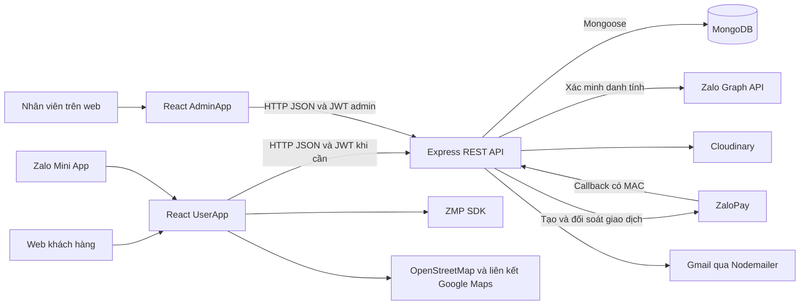
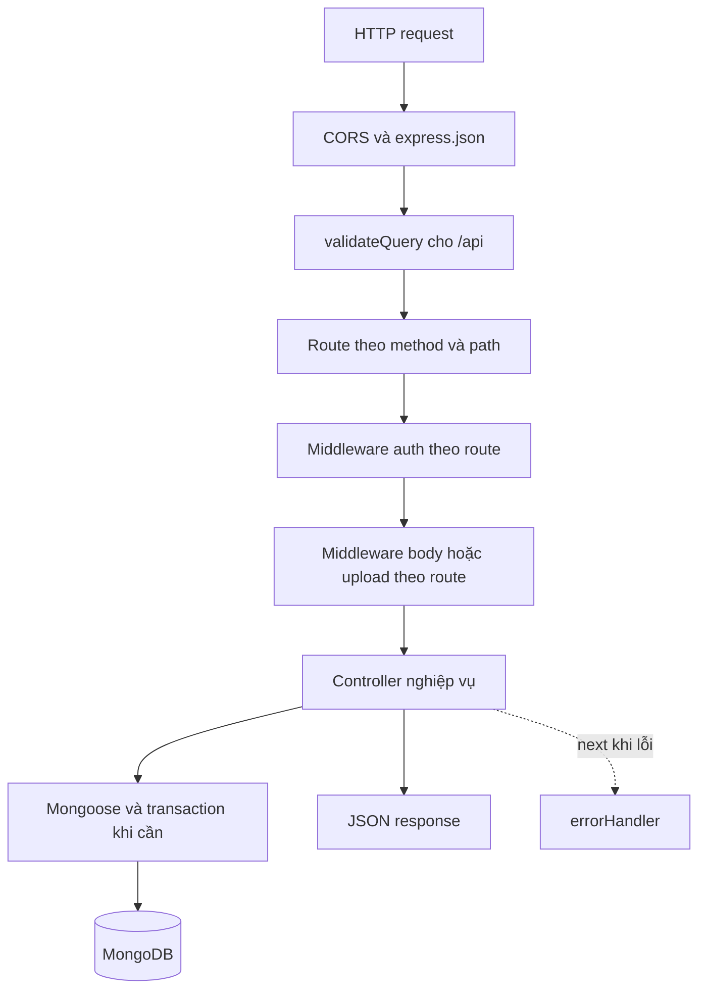
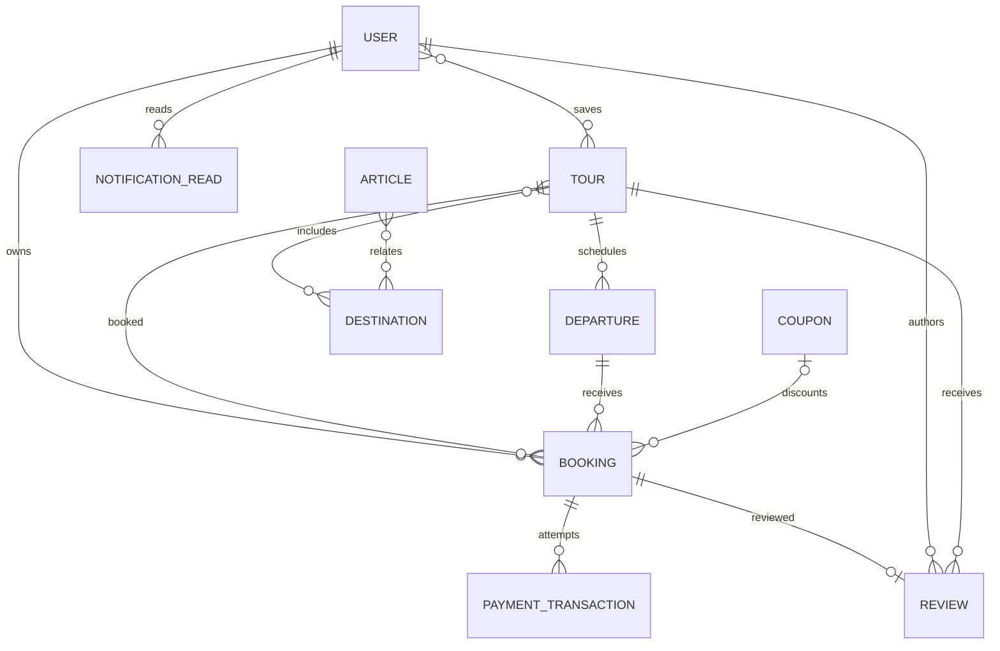
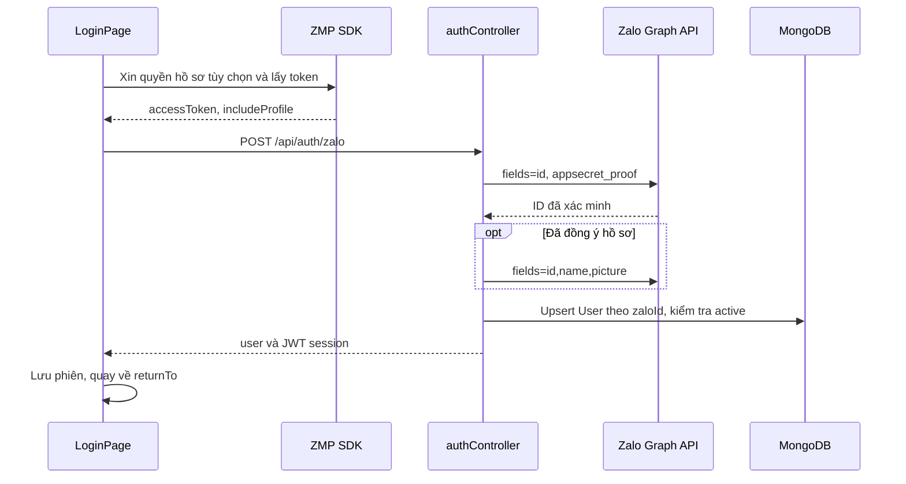
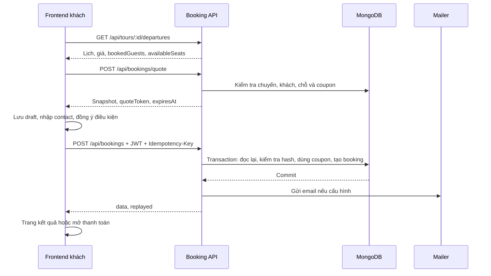
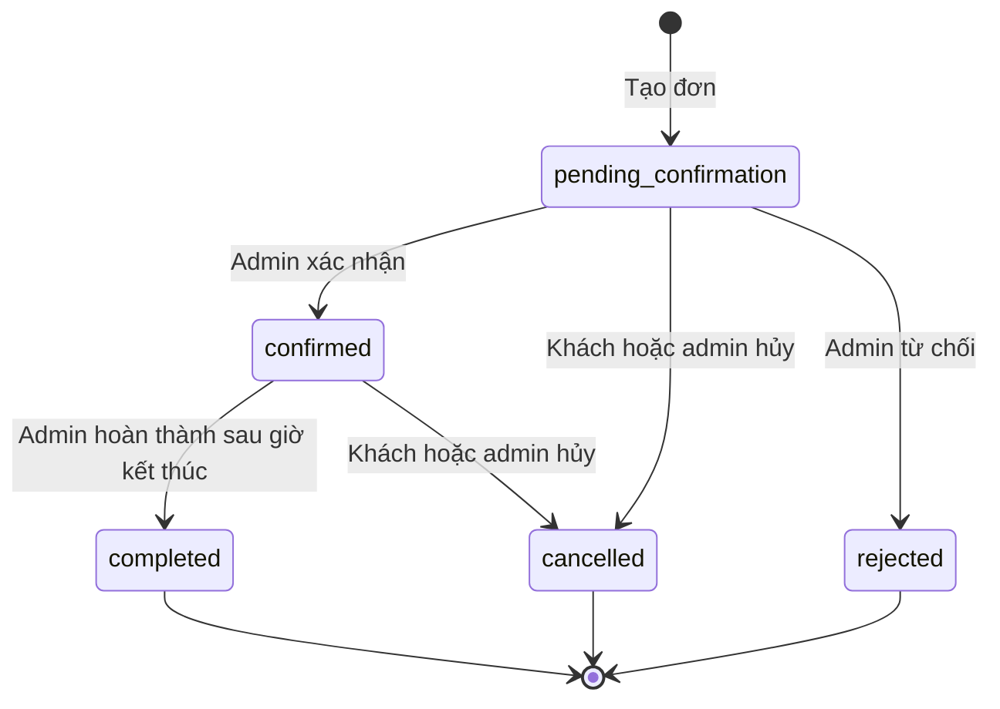

# VNA Đắk Song Booking Tour

Ứng dụng khám phá du lịch và đặt tour của VNA Group gồm **giao diện khách hàng web/Zalo Mini App**, **cổng quản trị web** và **backend REST API dùng MongoDB**. Khách khám phá nội dung, chọn chuyến, nhận báo giá, gửi yêu cầu đặt tour và theo dõi đơn; nhân viên quản lý nội dung, lịch khởi hành, xác nhận chuyến và đối soát thanh toán.

Tài liệu được đối chiếu mã nguồn ngày **11/10/2026**. Phiên bản công nghệ bên dưới lấy từ package manifests. Các luồng mô tả triển khai hiện tại; mã tích hợp/build/test bằng fixture không tự chứng minh dịch vụ bên ngoài đã hoạt động trên môi trường thật.

## Mục lục

1. [Tài liệu và phạm vi](#1-tài-liệu-và-phạm-vi)
2. [Kiến trúc tổng thể](#2-kiến-trúc-tổng-thể)
3. [Công nghệ và mục đích](#3-công-nghệ-và-mục-đích)
4. [Cấu trúc repository](#4-cấu-trúc-repository)
5. [Backend sử dụng MVC như thế nào](#5-backend-sử-dụng-mvc-như-thế-nào)
6. [Frontend: page, component, hook, context](#6-frontend-page-component-hook-context)
7. [Mô hình dữ liệu](#7-mô-hình-dữ-liệu)
8. [Quy trình nghiệp vụ](#8-quy-trình-nghiệp-vụ)
9. [Trạng thái và quy tắc](#9-trạng-thái-và-quy-tắc)
10. [Hợp đồng giữa frontend và backend](#10-hợp-đồng-giữa-frontend-và-backend)
11. [Cài đặt local](#11-cài-đặt-local)
12. [Build và triển khai](#12-build-và-triển-khai)
13. [Kiểm thử](#13-kiểm-thử)
14. [Giới hạn hiện tại](#14-giới-hạn-hiện-tại)
15. [Cách đọc và mở rộng source](#15-cách-đọc-và-mở-rộng-source)

## 1. Tài liệu và phạm vi

| Tài liệu | Mục đích |
| --- | --- |
| [README tổng](README.md) | Giải thích toàn hệ thống, kiến trúc, dữ liệu và quy trình |
| [README backend](backend/README.md) | Chi tiết module, schema, API, quyền, transaction, cấu hình và script |
| [README frontend](frontend/README.md) | Entry/router, màn hình, component, hook/context, API client, style và build |
| [Bàn giao](BAN_GIAO.md) | Nhận source, cấu hình và thử đăng nhập Zalo |
| [Hướng dẫn thuyết trình](PRESENTATION_GUIDE.md) | Hỗ trợ trình bày dự án; đối chiếu code/README khi xác định hành vi hiện tại |

Địa chỉ triển khai được ghi trong tài liệu bàn giao: [web khách hàng](https://vna-daksong-frontend.vercel.app), [web quản trị](https://vna-daksong-frontend.vercel.app/admin), [backend](https://vna-daksong-backend.vercel.app). Đây là địa chỉ tham chiếu, không phải báo cáo kiểm tra uptime hoặc xác nhận phát hành Zalo trong lần cập nhật tài liệu này.

| Vai trò | Chức năng hiện có | Quyền quyết định tại backend |
| --- | --- | --- |
| Guest | Đọc điểm đến, bài viết, tour, chuyến, đánh giá, coupon khả dụng; lấy quote | Nội dung published và điều kiện công khai |
| User | Lưu tour, tạo booking, xem/hủy đơn của mình, thanh toán, đánh giá, đọc thông báo cá nhân | JWT, User.active, kiểm tra chủ sở hữu |
| Admin | Quản lý nội dung/chuyến/coupon, booking/dashboard, upload, query/refund ZaloPay | JWT và User.role từ database |

Ứng dụng dùng mô hình **gửi yêu cầu rồi VNA xác nhận**. Tạo đơn xong chưa đồng nghĩa chuyến confirmed hoặc tiền paid. Không có API đăng ký admin công khai; tài khoản nhân viên tạo bằng script riêng.

## 2. Kiến trúc tổng thể



Hai giao diện dùng cùng dự án frontend và API. `main.tsx` chọn nhánh bằng môi trường/URL rồi tải bằng React.lazy: web có đường dẫn bắt đầu `/admin` mở AdminApp; trong Zalo có `window.APP_ID` thì mở UserApp.

Backend truy cập MongoDB và giữ secret. Frontend chỉ có cấu hình công khai, token phiên và dữ liệu hiển thị. OA là đường liên hệ/lối truy cập được cấu hình bằng ID công khai; chưa có dịch vụ gửi tin OA/ZNS tự động trong source.

## 3. Công nghệ và mục đích

| Phần | Công nghệ khai báo | Vai trò |
| --- | --- | --- |
| Runtime | Node.js `^20.19.0 \|\| >=22.12.0` | Chạy API, script dữ liệu, test và build |
| Backend | Express `^5.2.1`, JavaScript ESM | HTTP routing, middleware, JSON API |
| Database | Mongoose `^9.11.0`, MongoDB | Schema, reference, index, truy vấn và transaction |
| Xác thực | jsonwebtoken, bcryptjs | JWT HS256, hash/so sánh mật khẩu admin |
| Thanh toán | Axios, CryptoJS, Moment | Gọi provider, HMAC, mã giao dịch theo UTC+7 |
| Ảnh/email | Multer, Cloudinary, Nodemailer | Ảnh trong memory, upload cloud, email HTML/text |
| Nhập nội dung | htmlparser2 | Phân tích nội dung cổng du lịch |
| Frontend | React `^18.3.1`, TypeScript `~5.9.0` | Component và kiểm tra kiểu khi phát triển |
| Router | React Router `^6.30.1`, ZMPRouter | Điều hướng web/Zalo |
| Zalo | zmp-sdk `^2.53.0`, zmp-ui `^1.11.14` | Token, hồ sơ có xin quyền, storage, App/Snackbar/router |
| Build/style | Vite `^5.4.14`, zmp-vite-plugin, Tailwind/PostCSS, CSS riêng | Dev server, bundle web/Zalo, style phân hệ |
| Bản đồ | Leaflet `1.9.4` | Marker trên OpenStreetMap, liên kết Google Maps |
| Test | Node test runner, Chrome headless/CDP | Test logic, API với DB riêng, thao tác UI |

ZaUI cung cấp khung Mini App; phần lớn giao diện là component React, HTML/SVG và CSS riêng. Manifests hiện không có Redux, React Query hoặc Playwright.

## 4. Cấu trúc repository

```text
vna-daksong-booking-tour/
├── README.md, BAN_GIAO.md, PRESENTATION_GUIDE.md
├── backend/
│   ├── server.js             # Express app, middleware, route, DB và listen local
│   ├── api/index.js          # Export Express app cho Vercel
│   ├── config/               # db.js, cloudinary.js, mailer.js
│   ├── routes/               # 11 nhóm route HTTP
│   ├── middlewares/          # auth, inputValidation, upload, error
│   ├── controllers/          # 10 controller nghiệp vụ
│   ├── models/               # 10 Mongoose model
│   ├── utils/                # validation, email, review, nội dung, vị trí
│   ├── data/                 # Danh mục địa điểm cho script
│   ├── assets/email/         # Logo gửi kèm email
│   ├── scripts/              # Import/cập nhật dữ liệu có chủ đích
│   ├── tests/                # API, auth, validation, email, nội dung, vị trí
│   ├── createAdmin.js
│   └── .env.example, package.json, package-lock.json, vercel.json
├── frontend/
│   ├── src/
│   │   ├── main.tsx          # Chọn UserApp hoặc AdminApp
│   │   ├── UserApp.tsx       # Provider và router khách
│   │   ├── App.tsx           # Shell, route, vùng cuộn và bottom tabs
│   │   ├── pages/            # Auth, User, Admin
│   │   ├── components/       # common, layout, tour, booking, account, admin
│   │   ├── context/          # Phiên, draft, preview, notification, refresh, toast
│   │   ├── hooks/            # API, form/query admin, đồng bộ payment
│   │   ├── utils/            # HTTP, Zalo adapter, format, catalog, vị trí
│   │   ├── types/            # api.ts, admin.ts, location.ts
│   │   ├── data/             # Sample JSON và preview fixtures
│   │   ├── assets/           # Ảnh, font, thông tin nguồn
│   │   └── styles/, index.css
│   ├── scripts/, tests/
│   └── app-config.json, vite.config.ts, .env.example, package.json, ...
└── scripts/
    ├── start-zalo-local.ps1
    └── stop-zalo-local.ps1
```

`node_modules`, `dist`, `www`, `test-results`, `tmp`, `docs`, skill local và bộ thiết kế Stitch bị gitignore. `backend/scripts/seed.js` và `seedTestUsers.js` cũng là file local bị bỏ qua; không bảo đảm tồn tại sau clone và không phải bước khởi động bắt buộc. File `.env` chứa secret không được commit.

## 5. Backend sử dụng MVC như thế nào

### 5.1 Ý nghĩa và ánh xạ vào source

MVC chia trách nhiệm giữa Model (dữ liệu), View (trình bày) và Controller (xử lý hành động). Backend tổ chức theo MVC cho API kết hợp phân tầng route/middleware/helper:

| Thành phần | Vị trí | Trách nhiệm cụ thể |
| --- | --- | --- |
| Model | `backend/models/` | Field, enum, reference, index, validation; phương thức coupon |
| Controller | `backend/controllers/` | Đọc request, nghiệp vụ, quyền sở hữu, truy vấn, transaction, response |
| View cấp hệ thống | React ở frontend | Hiển thị JSON và nhận thao tác |
| Route | `backend/routes/` | Ghép HTTP method/path với middleware và controller |
| Middleware | `backend/middlewares/` | Xác thực, admin, validation, upload, lỗi |
| Helper/config | `backend/utils/`, `config/` | Quy tắc dùng lại, email, DB, SDK dịch vụ |

Backend không render template trang HTML. JSON là đầu ra API; React là giao diện độc lập gọi API, không phải thư mục views bên trong Express. Email HTML là tiện ích gửi thư, không phải view engine của website.

Mục đích chia lớp là giảm việc một module phải làm mọi thứ: route thay đổi URL không cần viết lại nghiệp vụ; middleware phân quyền dùng lại trên nhiều endpoint; schema tập trung ràng buộc dữ liệu; frontend thay bố cục không cần đổi model. Trong source hiện tại, nghiệp vụ phần lớn nằm ở controller; chưa có lớp services/repositories/Presenter riêng. `utils` được gọi khi cần, không phải bước bắt buộc sau model.

### 5.2 Vòng đời request



Ví dụ `POST /api/bookings`: route → protect tải User từ JWT → validateBody kiểm tra form và Idempotency-Key → createBooking kiểm tra quote/điều kiện, ghi transaction → trả data/replayed → frontend mở trang kết quả hoặc thanh toán.

`server.js` vừa tạo Express app vừa gọi connectDB và listen local. Vercel nhận app qua `api/index.js`; có biến VERCEL thì không listen. `db.js` kiểm tra cờ kết nối và readyState để tái sử dụng kết nối đang hoạt động. Source chưa tách `app.js`; hiệu năng khởi tạo cần đo trên môi trường triển khai.

## 6. Frontend: page, component, hook, context

### 6.1 Mô hình giao diện

Frontend là SPA theo component, quản lý state bằng React hooks và Context. Không áp dụng MVC backend nguyên xi cho từng component.

| Lớp | Công việc | Ví dụ |
| --- | --- | --- |
| Page | Màn hình, đọc route/query, ghép UI, điều phối thao tác | TourDetailPage, ReviewBookingPage, BookingsPage |
| Component | Khối giao diện dùng lại, nhận props/callback | TourCard, GuestCounter, CouponPicker, Header |
| Hook | Gom state/effect và thao tác bất đồng bộ lặp lại | useApi, useBookingPaymentSync, useAdminQuery |
| Context | Chia sẻ state qua nhiều page/component | AuthContext, BookingDraftContext, NotificationContext |
| Utility/adapter | Hàm thuần và cầu nối hạ tầng | api.ts, zalo.ts, format.ts, tourLocations.ts |
| Type | Hợp đồng TypeScript ở thời điểm biên dịch | Tour, Booking, Quote, ListResponse |
| Style/asset | Bố cục, màu, state hiển thị, ảnh/font | styles/, assets/ |

TypeScript không tự xác thực JSON ở runtime. Validation frontend giúp sửa form sớm; backend kiểm tra lại mọi dữ liệu quan trọng.

### 6.2 Component phối hợp ra sao?

Ở SelectDeparturePage, page đọc Tour/Departure bằng useApi, giữ chuyến và số khách được chọn, truyền số lượng/callback cho GuestCounter, truyền subtotal và mã cho CouponPicker. Bấm tiếp tục gọi API quote rồi lưu draft vào Context; ReviewBookingPage đọc draft để trình bày giá, nhận contact và gửi yêu cầu.

| Nhóm component | Vai trò |
| --- | --- |
| common | Icon, Photo, ImageGallery, AccountAvatar, AppLink, loading/error/empty |
| layout | Header/back, 5 bottom tabs, chuông thông báo, kéo làm mới, AdminLayout |
| tour | Card tour/điểm đến, RatingStars, TourReviews, TourLocationMap |
| booking | GuestCounter, CouponPicker, BookingSteps, BookingProgress, BookingTicketCode |
| account | AccountMenuItem |
| admin | Button/Field/Modal/Pagination..., form nội dung, DestinationPicker, icon riêng |

Một số component có state và gọi API, ví dụ TourReviews/CouponPicker. useApi gom request đọc; mutation vẫn có ở handler page/component. Không thể nói toàn bộ logic API đã nằm ngoài UI.

### 6.3 State và vòng đời

| Dữ liệu | Nơi quản lý | Cách tồn tại |
| --- | --- | --- |
| Phiên khách | AuthContext và zalo.ts | Native storage trong Zalo; sessionStorage trên web |
| Phiên admin | AdminAuthContext và adminApi.ts | SessionStorage riêng, key riêng |
| Draft/attempt booking | BookingDraftContext | Bộ nhớ React; giữ qua điều hướng trong app, mất khi reload |
| Dữ liệu API/loading/error | useApi hoặc hook admin | Theo path và lần refresh |
| Filter/phân trang | URL search params trên màn danh sách | Có thể giữ khi quay lại cùng URL |
| Thông báo | NotificationContext + API | Refresh 30 giây khi hiển thị/focus/sự kiện booking |
| Preview | PreviewContext và fixtures | Chỉ dev với query preview=1 |

## 7. Mô hình dữ liệu



Các đường nối là quan hệ logic qua ObjectId/mảng reference; MongoDB không tự tạo foreign key SQL. Controller kiểm tra quan hệ và điều kiện nghiệp vụ.

| Model | Nội dung và mục đích |
| --- | --- |
| User | Danh tính Zalo hoặc email admin, role/active, savedTours, điểm/hạng |
| Destination | Điểm đến, category, địa chỉ, ảnh/nguồn, ghi chú; vị trí/nhóm/khu vực tùy chọn |
| Article | Nội dung cẩm nang, category, điểm liên quan, ảnh/nguồn, publishedAt |
| Tour | Sản phẩm/tuyến: thời lượng, itinerary, điểm liên quan/đón, includes/excludes, chính sách, referencePrice |
| Departure | Một chuyến của tour: giờ đi, hạn đặt, adultPrice/childPrice, giới hạn khách |
| Booking | Yêu cầu theo chuyến, contact, snapshot, status/paymentStatus, history, idempotency |
| Coupon | Điều kiện áp dụng, hạn lượt, cách tính discount |
| PaymentTransaction | Mỗi attempt thanh toán, provider ID, tiền, callback/query/refund |
| Review | Một đánh giá gắn booking completed; tối đa một review mỗi booking |
| NotificationRead | Biên nhận đọc; nội dung thông báo được dựng từ Article/Booking.history |

**Tour và Departure:** cùng sản phẩm có nhiều chuyến với lịch/giá khác nhau. **Booking và PaymentTransaction:** một booking có thể có nhiều lần thử thanh toán. **Reference và snapshot:** đơn giữ giá/lịch/chính sách lúc tạo, không đổi theo nội dung tour được sửa sau đó.

## 8. Quy trình nghiệp vụ

### 8.1 Khám phá

Khách mở trang chủ/Khám phá/Tour → page gọi API → backend lọc published → card trình bày → mở chi tiết → đọc thêm chuyến và reviews. Tour có thể dùng giá tham khảo khi chưa có chuyến mở; giá đặt thực tế luôn đến từ Departure/quote.

ExplorePage dùng readCatalog tải tất cả trang bài viết/điểm đến, khử trùng điểm đến, lọc và phân trang UI. ToursPage lọc/phân trang ở backend. Bản đồ chỉ đặt marker tại điểm có tọa độ; địa điểm thiếu tọa độ vẫn được liệt kê.

### 8.2 Đăng nhập



Backend không tin tên/avatar/role từ payload client. Từ chối quyền hồ sơ vẫn có thể đăng nhập bằng ID. JWT HS256 có issuer `vna-daksong-api`, audience `session`, hạn 1 ngày; middleware tải quyền hiện tại từ database.

Admin gửi email/password → bcrypt compare → JWT → lưu phiên admin riêng. Mock login tạo ID từ `mock_` + số điện thoại, phụ thuộc ALLOW_MOCK_LOGIN; là công cụ thử browser, không phải xác minh Zalo.

### 8.3 Quote và tạo đơn



Quote tối đa 600 giây, ngắn hơn nếu gần bookingDeadline. Token có audience `quote`, chứa chuyến/số khách/hash snapshot. Tạo đơn gửi quoteToken, contact, note, coupon, paymentMethod; không gửi total/userId/status để quyết định dữ liệu.

Backend tính lại giá và điều kiện trong transaction, đối chiếu hash; thay đổi giá/điều kiện thì trả xung đột để lấy quote mới. Idempotency-Key cùng payload trả booking cũ với replayed=true; cùng key khác payload trả 409. Frontend giữ key/payload sau lỗi mạng/5xx để gửi lại cùng attempt, chưa lưu qua reload.

**Quote chưa giữ chỗ:** bước quote tính tổng khách hiện có; createBooking chưa aggregate lại capacity trong transaction. Source chưa bảo đảm không vượt sức chứa khi nhiều quote hợp lệ được gửi đồng thời.

### 8.4 Thanh toán và hoàn tiền

1. UI đặt mới có cash_on_arrival hoặc zalopay. Enum qr_transfer có ở backend nhưng chưa có lựa chọn này trên form đặt mới.
2. Backend kiểm tra booking của khách, pending/confirmed, unpaid và tổng tiền dương; ghi PaymentTransaction trước khi gọi ZaloPay.
3. Ký key1, gọi provider ngoài transaction DB, trả order_url; frontend mở URL.
4. Webhook kiểm MAC key2, app_id, mã giao dịch và amount. Query provider cũng dùng chung hàm ghi nhận tiền.
5. Booking và transaction cập nhật cùng transaction; callback lặp không ghi lại tiền/history. Paid không tự chuyển chuyến sang confirmed.
6. Frontend kiểm tra đơn ZaloPay unpaid mỗi 5 giây khi màn hiển thị và khi quay lại; query rồi đọc trạng thái đã lưu. Redirect URL không quyết định paid.
7. Đơn hủy/từ chối hoặc tiền trùng cần refund. Admin gửi refund, giữ mã yêu cầu rồi query; chỉ provider xác nhận thành công mới ghi refunded.

Timeout là kết quả chưa rõ, không phải chứng cứ chưa thu/hoàn tiền. Luồng merchant/sandbox/thực tế cần kiểm thử riêng với cấu hình tương ứng.

### 8.5 Admin, hoàn thành và đánh giá

Nhân viên đăng nhập /admin → Dashboard xem thống kê → Bookings kiểm tra/xác nhận đơn → ContentPage quản lý tour/điểm đến/bài viết → Departures quản lý chuyến → Coupons quản lý ưu đãi. Upload ảnh chỉ dành cho admin.

Confirmed tăng Tour.soldCount theo adults+children; hủy đơn confirmed giảm số này. Completed chỉ sau giờ đi + durationHours từ snapshot; cộng `floor(total / 10000)` điểm và tính hạng trong cùng transaction. Thanh toán callback không cộng điểm/soldCount.

Khách có booking completed tạo một review gắn booking; rating 1–5, comment 1–2000 ký tự. Chính tác giả được sửa; tác giả hoặc admin được xóa. Thống kê sao được aggregate từ Review, chưa có dữ liệu thì không bịa rating.

### 8.6 Thông báo và email

Thông báo trong app tổng hợp Article published và event Booking.history, lọc đơn đúng user. NotificationRead lưu từng ID hoặc mốc `__all__`. Guest chỉ thấy bài viết. Frontend polling, chưa có WebSocket/ZNS.

Email gửi sau commit booking mới. Thiếu cấu hình thì bỏ qua; gửi lỗi vẫn trả booking thành công. Replay đơn cũ không gửi email lần nữa. Email ghi nhận yêu cầu, không có nghĩa đã xác nhận tổ chức chuyến; chưa có queue/outbox hoặc retry độc lập.

## 9. Trạng thái và quy tắc



| Nhóm | Giá trị/quy tắc |
| --- | --- |
| Nội dung | draft, published, archived; DELETE chuyển archived |
| Departure | open, closed; DELETE đóng nhận đơn |
| Booking.status | pending_confirmation, confirmed, completed, cancelled, rejected |
| Booking.paymentStatus | unpaid, paid, refund_pending, refunded |
| Giao dịch | pending, success, failed, refund_pending, refunded; refundState riêng |
| Hạng | Bạc mặc định; Vàng từ 1.000 điểm; Kim Cương từ 5.000 điểm |
| Sức chứa | Model mặc định 50, phạm vi 1–200; API hiện chưa nhận maxCapacity |
| Giới hạn một đơn | Mặc định 20; API/schema 1–100, không vượt sức chứa |
| Trẻ em | Quote cần childPrice và childPolicy nếu children > 0 |
| Hủy/từ chối | Cần reason; paid chuyển refund_pending, chưa tự hoàn tiền |
| Đơn kết thúc | Controller không có luồng mở lại cancelled/rejected/completed |

Contact tạo đơn bắt buộc tên, số di động Việt Nam, email; schema email cho phép rỗng để tương thích dữ liệu cũ. Tiền là VND nguyên đồng. Thời điểm lưu Date/ISO, hàm hiển thị chính dùng Asia/Ho_Chi_Minh.

## 10. Hợp đồng giữa frontend và backend

| Hành động | API chính | Module/data |
| --- | --- | --- |
| Khám phá | /api/destinations, /api/articles | Controller/model nội dung |
| Tour/chi tiết/vị trí | /api/tours, /api/tours/:id | Tour, Destination, Review, tourLocations |
| Chuyến | /api/tours/:id/departures | Departure, Booking |
| Login/profile | /api/auth/* | User, authController |
| Quote/booking | /api/bookings/quote, /api/bookings | Booking, Tour, Departure, Coupon |
| Đơn cá nhân | /api/bookings/mine, /api/bookings/:id | Booking, PaymentTransaction |
| Payment/refund | /api/payments/zalopay/* | paymentController |
| Lưu tour | /api/tours/:id/save, /api/tours/saved | User.savedTours |
| Review | /api/tours/:id/reviews*, /api/reviews/:id | Review, Booking |
| Thông báo | /api/notifications và read routes | Article, Booking.history, NotificationRead |
| Dashboard | /api/bookings/dashboard-data | Aggregation và đếm dữ liệu |

api.ts/adminApi.ts thêm /api vào VITE_API_BASE_URL, timeout 15 giây. URL cấu hình là base backend như `http://localhost:8000`, không thêm /api lần nữa. Response chưa có envelope duy nhất: list thường {data,pagination}, chi tiết nội dung trả object, booking {data}, login {user,token,...}.

API admin dùng resource chung có guard, không có prefix /api/admin/* tổng quát. totalRevenue dashboard cộng snapshot.total của đơn confirmed/completed, chưa lọc paid: đó là giá trị đơn, không phải tiền thực thu.

## 11. Cài đặt local

Cần Node đúng engines, npm và MongoDB hỗ trợ transaction (replica set hoặc Atlas). Hai package độc lập; root không có package.json.

### Backend, terminal thứ nhất

```powershell
cd backend
npm.cmd ci
Copy-Item .env.example .env
# Điền MONGO_URI, JWT_SECRET ít nhất 32 ký tự.
npm.cmd run dev
```

Chỉ copy env khi chưa có file cần giữ. Mặc định http://localhost:8000. GET / trả tên dịch vụ; gọi /api/tours?limit=1 để kiểm tra thêm đường đọc DB. Root response không kiểm chứng DB.

Điền ADMIN_NAME/ADMIN_EMAIL/ADMIN_PASSWORD trong backend .env rồi chạy:

```powershell
npm.cmd run create:admin
```

DB mới có thể trống: dùng admin tạo nội dung/tour/chuyến. Script cập nhật mẫu cần dữ liệu khớp điều kiện, không phải seed chung bắt buộc. Xem [README backend](backend/README.md) cho cấu hình/script.

### Frontend, terminal thứ hai

```powershell
cd frontend
npm.cmd ci
Copy-Item .env.example .env
# VITE_API_BASE_URL=http://localhost:8000
npm.cmd run dev
```

| URL | Mục đích |
| --- | --- |
| http://localhost:5173/ | Khách dùng API |
| http://localhost:5173/admin | Quản trị |
| http://localhost:5173/?preview=1 | Fixtures chỉ trong dev; không gửi đơn thật |

Browser có form mock, backend phải cho phép. Zalo login cần mở trong Zalo. Query preview=1 không bật bộ mẫu trên production vì PreviewContext kiểm tra import.meta.env.DEV.

## 12. Build và triển khai

| Mục tiêu | Lệnh/cấu hình | Kết quả |
| --- | --- | --- |
| Backend Node | Backend: npm.cmd start | server.js listen khi không có VERCEL |
| Backend Vercel | Root backend, vercel.json | Mọi path vào api/index.js |
| Web frontend | Frontend: npm.cmd run build | Typecheck + Vite, output dist/ |
| Xem web build | npm.cmd run preview | dist tại http://localhost:4173 |
| Zalo frontend | npm.cmd run build:zalo | Typecheck + Vite/plugin, output www/ |
| Web hosting | Frontend vercel.json | Rewrite về index.html, refresh /admin/* |

VITE_* được đưa vào bundle lúc build. Đổi API cần build lại; không đưa secret vào VITE_*. .env.local có thể ghi đè .env, nhất là sau khi dùng tunnel.

Script start-zalo-local chạy backend với mock tắt, mở Cloudflare tunnel, đặt URL HTTPS trong frontend/.env.local; script stop dừng process của phiên và khôi phục URL cũ nếu chưa bị sửa. Hướng dẫn cụ thể trong README backend. Điện thoại không truy cập backend trên máy dev bằng localhost của điện thoại.

Zalo build còn cần app/tài khoản có quyền, cấu hình API và test thiết bị. www hoặc QR từ công cụ chưa tự chứng minh đã được duyệt/Publish. Repository không tự phát hành chỉ bằng npm build.

## 13. Kiểm thử

| Nhóm | Lệnh có sẵn | Phạm vi |
| --- | --- | --- |
| Logic backend | test:auth, test:validation, test:email, test:portal, test:tour-content | Helper/controller; auth stub model/provider |
| API tích hợp | Backend test:api, test:notifications, test:locations | DB test riêng, tự dọn DB của test |
| Refund transport | Backend: node --test tests/zalopay-refund-transport.test.mjs | HTTP local, UTF-8 form POST và lỗi provider |
| Logic frontend | test:explore, test:locations | Catalog và link bản đồ |
| UI | Frontend test:ui, test:notifications, test:scroll, test:admin | Chrome headless, dev server, fixture/intercept |
| Compile | typecheck, build, build:zalo | Kiểu và bundle |

API tổng hợp dùng HTTP/controller thật và MongoDB test riêng, mô phỏng dịch vụ ngoài. UI test không chứng minh đã thu tiền, gửi mail hay đăng nhập Zalo thật. Harness có thể đặt CHROME_PATH/UI_BASE_URL; báo cáo ở test-results bị gitignore.

Số ca/pass/fail phải lấy từ lần chạy tương ứng. Lần chỉnh tài liệu này không dùng kết quả test cũ để tuyên bố source đã được kiểm thử toàn bộ hoặc đã triển khai công khai.

## 14. Giới hạn hiện tại

| Điểm cần hiểu | Triển khai |
| --- | --- |
| Chỗ khi gửi đồng thời | Quote kiểm capacity; create chưa tính lại tổng khách trong transaction |
| Field quản trị | Model có maxCapacity/referencePrice nhưng CRUD validator chưa nhận |
| CORS | server.js gọi cors() mặc định; CLIENT_URL phục vụ redirect, chưa là allowlist |
| Realtime | Notification/payment polling; dashboard tải/refresh qua HTTP, chưa WebSocket |
| Thu tiền thủ công | Chưa có API riêng đánh dấu đã thu cash/qr |
| Email | Gửi trực tiếp sau commit, chưa queue/outbox/retry |
| Account mở rộng | Một số panel ví/hành khách/kho ảnh/ZNS là nội dung hoặc preview, chưa CRUD backend riêng |
| QR/check-in | Đơn thật dùng mã đơn; QR preview chỉ minh họa |
| DB startup | connectDB được gọi nhưng không await trước listen |
| Lỗi | Middleware chung tồn tại; nhiều controller vẫn catch/trả riêng |

## 15. Cách đọc và mở rộng source

Đọc một tính năng theo đường đi của dữ liệu. Booking: SelectDeparturePage → ReviewBookingPage → BookingDraftContext/api.ts → bookingRoutes → bookingController → Booking/Departure/Tour/Coupon. Nội dung: ContentPage/ContentForm → resource routes → controller → model → page khách.

Thêm field phải đối chiếu model, bodySchemas/controller, TypeScript type, form, response và UI. Field trong Mongoose chưa chắc HTTP API cho phép sửa. Thêm route admin cần protect/adminOnly tại backend và busy/error/retry tại frontend; ẩn nút chưa đủ bảo vệ quyền.

Đổi trạng thái cần xem transition bookingController, event paymentController, notifications từ history, nhãn frontend và test liên quan. Đừng suy confirmed từ paid hoặc cộng loyalty/soldCount trong callback tiền.

Nguồn ảnh ở frontend/src/assets/stitch/*.json, nguồn nội dung ở trường sources. Font Inter có [giấy phép SIL OFL](frontend/src/assets/fonts/Inter-OFL.txt). Bộ thiết kế local không cần để build từ Git; giữ credit và kiểm tra quyền sử dụng asset khi phát hành.
