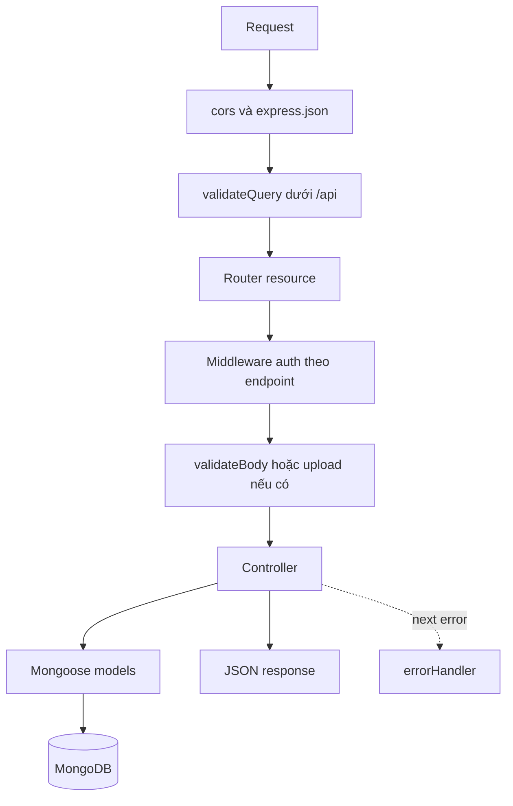
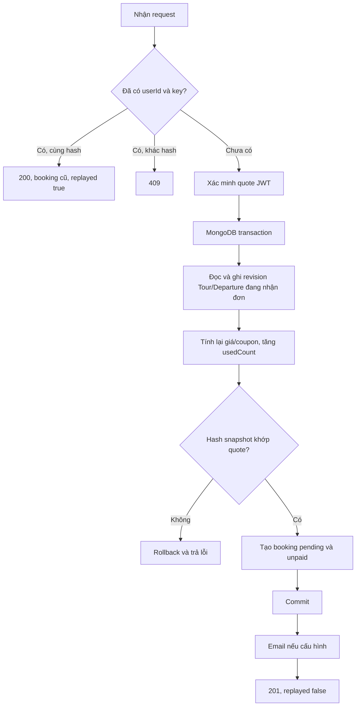

# Backend VNA Đắk Song Booking Tour

Backend REST API viết bằng JavaScript ESM, Express 5 và Mongoose. Phục vụ cùng lúc giao diện khách web/Zalo Mini App và cổng quản trị. Tài liệu đối chiếu source ngày **11/10/2026**; xem [README tổng](../README.md) để hiểu hệ thống và [README frontend](../frontend/README.md) để nối API với màn hình.

## Mục lục

1. [Cài đặt và cấu hình](#1-cài-đặt-và-cấu-hình)
2. [Kiến trúc, MVC và vòng đời request](#2-kiến-trúc-mvc-và-vòng-đời-request)
3. [Cấu trúc và trách nhiệm module](#3-cấu-trúc-và-trách-nhiệm-module)
4. [Authentication và phân quyền](#4-authentication-và-phân-quyền)
5. [Mô hình dữ liệu](#5-mô-hình-dữ-liệu)
6. [Quy ước API và validation](#6-quy-ước-api-và-validation)
7. [Danh sách endpoint](#7-danh-sách-endpoint)
8. [Quote, snapshot và tạo booking](#8-quote-snapshot-và-tạo-booking)
9. [Chuyển trạng thái và hội viên](#9-chuyển-trạng-thái-và-hội-viên)
10. [ZaloPay, đối soát và hoàn tiền](#10-zalopay-đối-soát-và-hoàn-tiền)
11. [Nội dung, địa điểm, đánh giá và thông báo](#11-nội-dung-địa-điểm-đánh-giá-và-thông-báo)
12. [Upload và email](#12-upload-và-email)
13. [Script dữ liệu](#13-script-dữ-liệu)
14. [Kiểm thử](#14-kiểm-thử)
15. [Chạy production, Vercel và tunnel local](#15-chạy-production-vercel-và-tunnel-local)
16. [Lỗi và giới hạn triển khai](#16-lỗi-và-giới-hạn-triển-khai)

## 1. Cài đặt và cấu hình

Node.js theo engines `^20.19.0 || >=22.12.0`. Package độc lập với frontend. MongoDB cần replica set hoặc Atlas cho transaction ở booking/payment.

Chạy trong thư mục backend:

```powershell
npm.cmd ci
Copy-Item .env.example .env
# Điền MONGO_URI và JWT_SECRET trong .env.
npm.cmd run dev
```

Chỉ copy nếu chưa có env cần giữ. Dev dùng nodemon với danh sách watch trong package.json. Production Node dùng `npm.cmd start`. Mặc định cổng 8000. Không có bước compile TypeScript cho backend.

### Biến môi trường thực tế

| Biến | Dùng tại đâu | Ý nghĩa |
| --- | --- | --- |
| PORT | server.js | Cổng Node local, mặc định 8000 |
| MONGO_URI | config/db.js và script | Chuỗi kết nối DB; giữ trong backend |
| JWT_SECRET | auth/booking middleware/controller | Tối thiểu 32 ký tự, ký session và quote |
| CLIENT_URL | paymentController | Base frontend để redirect về /booking/success/:id; không phải CORS allowlist |
| ALLOW_MOCK_LOGIN | authController | Bật/tắt login thử; production tắt trừ khi đặt chính xác true |
| NODE_ENV | authController | Tham gia điều kiện mock login |
| VERCEL | server.js/config/db.js | Không listen local; nhánh xử lý lỗi DB theo môi trường |
| VERCEL_REGION | auth diagnostics | Nhãn vùng trong log chẩn đoán xác minh Zalo |
| ZALO_APP_SECRET | authController | HMAC appsecret_proof khi gọi Graph API |
| ZALO_APP_ID | .env.example | Thông tin app để cấu hình; authController hiện không dùng biến này để đối chiếu ID token |
| ADMIN_NAME, ADMIN_EMAIL, ADMIN_PASSWORD | createAdmin.js | Chỉ tạo tài khoản admin bằng script |
| CLOUDINARY_CLOUD_NAME, CLOUDINARY_API_KEY, CLOUDINARY_API_SECRET | config/cloudinary.js | Upload ảnh |
| EMAIL_USER, EMAIL_PASS | config/mailer.js | Gmail và App Password cho Nodemailer |
| EMAIL_APP_URL | utils/email.js | Base URL tạo liên kết xem chi tiết đơn trong email |
| EMAIL_SUPPORT_PHONE | utils/email.js | Số hỗ trợ trong thư |
| EMAIL_SUPPORT_ADDRESS | utils/email.js | Được truyền thành supportEmail; là địa chỉ email hỗ trợ |
| ZALOPAY_APP_ID, ZALOPAY_KEY1, ZALOPAY_KEY2, ZALOPAY_ENDPOINT | paymentController | Tạo, kiểm chữ ký, query và refund ZaloPay |

Không in/commit URI có mật khẩu, secret hoặc token. Frontend không nhận các biến bí mật. Dùng endpoint/key cùng môi trường merchant đã được cấp; source suy URL query/refund từ ZALOPAY_ENDPOINT bằng new URL.

### Khởi tạo admin

Điền ba biến ADMIN_* rồi chạy:

```powershell
npm.cmd run create:admin
```

Script chuẩn hóa email, kiểm tra trùng email, yêu cầu password ít nhất 8 ký tự và tối đa 72 byte UTF-8, hash bcrypt với salt rounds 10, tạo User role admin/active. Chạy lại cùng email báo đã tồn tại, không tự thay mật khẩu/nâng quyền tài khoản hiện có.

## 2. Kiến trúc, MVC và vòng đời request

Backend theo cách tổ chức **routes → middleware → controllers → models**, có config/utils bổ trợ. Ở cấp hệ thống, React frontend là lớp trình bày; Express trả JSON, không có view engine/template trang HTML.

| Lớp | Mục đích |
| --- | --- |
| Route | Chọn endpoint, thứ tự route cụ thể trước route :id, gắn middleware |
| Middleware | Auth, role, validation, upload và lỗi chung |
| Controller | Request/response và nghiệp vụ, gồm transaction và gọi dịch vụ |
| Model | Schema, enum, index, reference, validation, phương thức dữ liệu |
| Config | Kết nối DB và cấu hình SDK |
| Utils | Quy tắc/helper dùng lại, email, nội dung, tổng hợp reviews/vị trí |

MVC giúp tách định tuyến, nghiệp vụ và dữ liệu để bảo trì/kiểm thử. Nghiệp vụ hiện tập trung tại controller; source chưa có services/repositories/Presenter riêng. Utils không phải tầng bắt buộc chạy sau Model.



server.js import dotenv trước các module đọc env, tạo app, gọi connectDB, gắn 11 resource, cuối cùng notFound/errorHandler. connectDB được gọi không await trước listen. config/db.js tái sử dụng kết nối qua cờ isConnected/readyState; không đo hoặc bảo đảm thời gian cold start.

Local mở cổng khi không có process.env.VERCEL. Trên Vercel, api/index.js import/export app. GET / trả `{ "service": "VNA Dak Song Booking API" }`; không kiểm tra trạng thái DB.

## 3. Cấu trúc và trách nhiệm module

```text
backend/
├── server.js
├── api/index.js
├── config/
│   ├── db.js
│   ├── cloudinary.js
│   └── mailer.js
├── controllers/
│   ├── authController.js
│   ├── destinationController.js
│   ├── articleController.js
│   ├── tourController.js
│   ├── departureController.js
│   ├── bookingController.js
│   ├── couponController.js
│   ├── reviewController.js
│   ├── notificationController.js
│   └── paymentController.js
├── routes/                    # Cùng resource, thêm uploadRoutes.js
├── middlewares/
│   ├── authMiddleware.js
│   ├── inputValidation.js
│   ├── uploadMiddleware.js
│   └── errorMiddleware.js
├── models/                    # 10 model trong phần 5
├── utils/
│   ├── inputValidation.js
│   ├── email.js
│   ├── zaloAuthDiagnostics.js
│   ├── reviewStats.js
│   ├── tourLocations.js
│   ├── tourContent.js
│   └── portalContent.js
├── scripts/
├── tests/
├── data/dakSongLocations.json
├── assets/email/vna-logo.png
├── createAdmin.js
└── .env.example, package.json, package-lock.json, vercel.json
```

| Controller/module | Trách nhiệm |
| --- | --- |
| authController | Xác minh Zalo, bổ sung profile tùy chọn, mock/admin login, trả phiên/profile |
| destinationController | Đọc/CRUD điểm đến, trạng thái xuất bản, dữ liệu vị trí |
| articleController | Đọc/CRUD bài viết, quan hệ điểm đến, publishedAt |
| tourController | Tìm/lọc/giá hiển thị, chi tiết/vị trí/review, CRUD, lưu tour |
| departureController | Chuyến theo tour, CRUD lịch/giá, enrich số khách/chỗ trống |
| bookingController | Quote, hash/snapshot, idempotency, tạo/hủy/chuyển trạng thái, điểm/dashboard |
| couponController | Coupon khả dụng, CRUD admin; phép tính nằm thêm trong Coupon model |
| reviewController | Đủ điều kiện, tạo/sửa/xóa review và response công khai |
| notificationController | Tổng hợp bài viết/history đơn, biên nhận đã đọc |
| paymentController | Tạo attempt, query/webhook, ghi nhận tiền, refund/query refund |
| uploadRoutes | Upload handler trực tiếp trong route, chưa tách uploadController |
| utils/inputValidation | Schema request, kiểm tra text/number/id/phone/email/date/url/query |
| utils/tourLocations | Trả điểm tuyến đúng thứ tự và điểm tập trung |
| utils/reviewStats | Aggregate trung bình, số lượng và phân bố sao |
| utils/tourContent, portalContent | Chuẩn hóa nội dung cho script dữ liệu |
| utils/zaloAuthDiagnostics | Làm sạch thông điệp provider để không log secret/token |
| utils/email | Dựng HTML/text và gửi mail ghi nhận booking |

## 4. Authentication và phân quyền

### JWT session

JWT HS256 dùng issuer `vna-daksong-api`, audience `session`, sub là User ObjectId, expiresIn 1 ngày. Login trả:

```json
{
  "user": { "_id": "USER_ID", "name": "Khách Zalo", "role": "user" },
  "token": "SESSION_JWT",
  "tokenType": "Bearer",
  "expiresIn": 86400
}
```

Các ID/token viết hoa trong ví dụ là placeholder cần thay, không phải giá trị hợp lệ để gửi API.

protect yêu cầu Authorization: Bearer, xác minh algorithm/issuer/audience/sub, đọc User từ DB, kiểm tra active rồi gắn req.user. Quyền không lấy từ role tự chèn vào JWT. adminOnly kiểm role từ req.user. optionalProtect cho phép không gửi token; nếu đã gửi Authorization thì token phải hợp lệ, không bỏ qua token sai.

### Zalo

POST /auth/zalo nhận accessToken và includeProfile tùy chọn. Backend gọi Graph fields=id với access_token và appsecret_proof HMAC SHA256. ID trả về phải là chuỗi số hợp lệ. Nếu includeProfile=true, backend thử đọc id/name/picture, kiểm ID khớp; hồ sơ lỗi/thiếu quyền không chặn login ID đã xác minh. User được upsert theo zaloId, mặc định Khách Zalo/user/active.

Không có API nhận trực tiếp zaloId/role từ client để tạo phiên. Frontend phải lấy SDK token, còn backend xác minh với Zalo. ZALO_APP_ID hiện chỉ là mục cấu hình trong example; không có kiểm app ID độc lập trong authController.

### Mock và admin

Mock nhận name/phone, tạo ID mock_ + phone. Bị chặn nếu ALLOW_MOCK_LOGIN=false; production chỉ cho phép khi giá trị true. Ngoài production, unset vẫn có thể cho phép; vì vậy không nên hiểu rằng endpoint luôn chỉ mở khi biến true.

Admin login nhận email/password, chuẩn hóa email, tìm admin active, select password, bcrypt compare. Password không được trả trong JSON. GET /auth/me trả `{ user }`.

### Quyền sở hữu

Booking detail/query tiền: owner hoặc admin. Tạo thanh toán: chỉ owner. Hủy qua /cancel: lọc đơn của chính người gọi; admin xử lý đơn người khác qua /status. Sửa review: chỉ tác giả, kể cả caller là admin. Xóa review: tác giả hoặc admin. Nhãn/quyền trên UI không thay các kiểm tra này.

## 5. Mô hình dữ liệu

Hầu hết model có timestamps và optimisticConcurrency. Trường immutable bảo vệ identity/reference quan trọng ở schema; controller vẫn cần kiểm tra payload và quan hệ.

| Model | Field chính | Ràng buộc đáng chú ý |
| --- | --- | --- |
| User | name, zaloId, email/password, avatar, role, active, savedTours, membershipTier, loyaltyPoints | zaloId/email unique sparse; zaloId immutable; password select:false và bị bỏ khi toJSON |
| Destination | name/slug/summary/description/category/address, images/sources, visitNotes, status; placeGroup/areaScope/locality/coordinates | slug unique; tọa độ latitude ±90, longitude ±180; field vị trí tùy chọn |
| Article | title/slug/summary/content/category, destinationIds, images/sources, status/publishedAt | slug unique; content tối đa 50.000 ký tự; category culture/food/travel_tips/story |
| Tour | name/slug/summary/description, durationHours/themes, destinationIds/itinerary, meetingPoint/meetingDestinationId, includes/excludes, chính sách, referencePrice/note, soldCount, bookingRevision | slug unique; duration 1–720; itinerary destinationId có thể null |
| Departure | tourId, departureAt/bookingDeadline, adultPrice/childPrice, maxGuestsPerBooking/maxCapacity, status, bookingRevision | deadline trước departure; giá nguyên 0–1 tỷ; maxCapacity mặc định 50, 1–200 |
| Booking | code/userId/tourId/departureId, adults/children/contact/note, snapshot, status/paymentStatus/paymentMethod, paidTransactionId, couponCode/couponId, history, idempotencyKey/requestHash | code unique; unique userId+idempotencyKey; reference gốc immutable |
| Coupon | code/description, discountType/value/maxDiscount/minOrderValue, validFrom/Until, usageLimit/usedCount, isActive | code unique uppercase; percentage ≤100; fixed nguyên đồng; thời gian hợp lệ |
| PaymentTransaction | bookingId/code, appTransId/amount/provider/status, rawCallback, paidAt/appliedAt, zpTransId, activeAttempt/expiresAt, refund IDs/state/time/note | appTransId unique; partial unique bookingId+provider khi activeAttempt=true |
| Review | tourId, bookingId, userId, rating/comment | bookingId unique; rating nguyên 1–5; comment 1–2000; strict throw |
| NotificationRead | userId, notificationId, readAt | Unique userId+notificationId; mốc __all__ dùng cùng collection |

### Reference, embedded document và index

Tour/Article/User dùng mảng reference cho điểm đến/tour đã lưu. Booking giữ ObjectId của User/Tour/Departure/Coupon nhưng nhúng snapshot/contact/history để đọc lại đơn theo dữ liệu đã chốt. Image/source/itinerary là subdocument; ảnh có url/alt/credit, nguồn có title/url/checkedAt.

Các index text ở Tour/Destination/Article hỗ trợ q bằng $text. Index trên trạng thái/thời gian/reference hỗ trợ truy vấn. Review và PaymentTransaction có index riêng cho danh sách theo tour/booking. Reference không tự tạo foreign key; controller thực hiện kiểm tra tồn tại.

### Model field và HTTP field khác nhau

Tour schema có referencePrice/referencePriceNote/soldCount; request validator/controller CRUD không cho client sửa các field này. Departure có maxCapacity nhưng API CRUD không nhận field đó, nên tạo qua API dùng mặc định 50. bookingRevision dùng nội bộ và select:false; không phải số ghế đang giữ.

Booking contact.email tùy chọn trong schema, nhưng API tạo booking yêu cầu email hợp lệ. Không suy hợp đồng HTTP chỉ từ schema Mongoose.

## 6. Quy ước API và validation

Base local `http://localhost:8000/api`. Body JSON, trừ upload dùng multipart. ID thường là MongoDB ObjectId 24 ký tự hex; appTransId và ID thông báo dùng định dạng riêng.

| Loại response | Dạng thường dùng |
| --- | --- |
| Danh sách | { data: [], pagination: { page, limit, total, pages } } |
| Chi tiết Tour/Destination/Article/Departure | Object trực tiếp |
| Booking | { data: booking }; detail có payments |
| Quote | Object giá trực tiếp, quoteToken/expiresAt/message |
| Login | { user, token, tokenType, expiresIn } |
| Profile | { user } |
| Reviews | { data, summary, pagination } |
| Notifications | { data, unreadCount, pagination } |
| Dashboard | { bookings, tours, destinations, openDepartures, totalRevenue } |

Không có envelope response thống nhất cho mọi route. PUT/PATCH nội dung/chuyến đều là cập nhật các field gửi lên, không yêu cầu replace toàn bộ object. Coupon chỉ có PUT; review chỉ có PATCH.

validateQuery chạy toàn cục dưới /api: chỉ nhận bộ lọc theo resource, mỗi giá trị là một chuỗi, chặn array/object/query trùng, kiểm kiểu và khoảng. page 1–10.000, limit 1–100. Controller có mặc định limit khác nhau theo API.

validateBody dùng whitelist: field không hỗ trợ bị từ chối; update cần ít nhất một field. Text chặn control character; money nguyên 0–1 tỷ; URL HTTP(S) không chứa tài khoản/mật khẩu; date kiểm ngày lịch và định dạng; phone/email kiểm quy tắc riêng. Không phải mọi route đều dùng validateBody: admin/mock login tự kiểm, webhook dùng định dạng provider.

## 7. Danh sách endpoint

Mọi path trong các bảng sau có prefix **/api**. Public/optional nghĩa là guest được gọi; token gửi kèm vẫn phải hợp lệ.

### 7.1 Authentication

| Method | Path | Quyền | Kết quả |
| --- | --- | --- | --- |
| POST | /auth/zalo | Public | Đổi token Zalo đã xác minh lấy session |
| POST | /auth/mock | Theo cấu hình dev | Login thử name/phone |
| POST | /auth/admin/login | Public | Admin email/password |
| GET | /auth/me | Có phiên | Profile hiện tại |

### 7.2 Nội dung và tour

| Method | Path | Quyền | Tác dụng |
| --- | --- | --- | --- |
| GET | /destinations | Public/optional | Danh sách điểm đến |
| GET | /destinations/:id | Public/optional | Chi tiết điểm đến |
| POST | /destinations | Admin | Tạo |
| PUT, PATCH | /destinations/:id | Admin | Cập nhật |
| DELETE | /destinations/:id | Admin | Chuyển archived |
| GET | /articles | Public/optional | Danh sách bài viết |
| GET | /articles/:id | Public/optional | Chi tiết bài viết |
| POST | /articles | Admin | Tạo |
| PUT, PATCH | /articles/:id | Admin | Cập nhật |
| DELETE | /articles/:id | Admin | Chuyển archived |
| GET | /tours | Public/optional | Danh sách, filter, giá từ chuyến, thống kê review |
| GET | /tours/saved | Có phiên | Tour published đã lưu |
| GET | /tours/:id | Public/optional | Chi tiết, routeDestinations/meetingDestination, review summary |
| POST | /tours/:id/save | Có phiên | Toggle saved tour |
| POST | /tours | Admin | Tạo tour |
| PUT, PATCH | /tours/:id | Admin | Cập nhật |
| DELETE | /tours/:id | Admin | Chuyển archived |
| GET | /tours/:id/departures | Public/optional | Các chuyến theo tour |
| GET | /tours/:id/reviews | Public/optional | Review và summary |
| GET | /tours/:id/reviews/eligibility | Có phiên | Booking đủ điều kiện và review của mình |
| POST | /tours/:id/reviews | Có phiên | Review booking completed của mình |

Không có GET /reviews/:id hoặc GET /departures/tour/:id trong routes, dù tên helper/comment cũ có thể gây nhầm.

| Resource | Query được hỗ trợ ngoài page/limit |
| --- | --- |
| destinations | q, status, category |
| articles | q, status, category, destinationId |
| tours | q, status, destinationId, theme, maxDurationHours, dateFrom, dateTo, minPrice, maxPrice, sort |
| departures | tourId, status |
| bookings | status, departureId, code |
| coupons | isActive, sort |
| notifications | type |

Sort tour: newest, duration, price_asc, price_desc, most_bought. Sort coupon: newest/oldest. Guest/user luôn bị lọc nội dung published dù gửi status khác; admin có thể đọc các trạng thái khác. Bộ lọc riêng còn được controller diễn giải theo từng endpoint.

### 7.3 Chuyến và booking

| Method | Path | Quyền | Tác dụng |
| --- | --- | --- | --- |
| GET | /departures | Admin | Danh sách lịch |
| GET | /departures/:id | Admin | Chi tiết lịch |
| POST | /departures | Admin | Tạo lịch |
| PUT, PATCH | /departures/:id | Admin | Cập nhật, không đổi tourId |
| DELETE | /departures/:id | Admin | Chuyển closed |
| POST | /bookings/quote | Public | Báo giá, không dùng protect/optionalProtect trên route |
| POST | /bookings | Có phiên | Tạo đơn, cần Idempotency-Key |
| GET | /bookings/mine | Có phiên | Đơn của mình |
| GET | /bookings | Có phiên | Admin xem toàn bộ; user chỉ xem của mình |
| GET | /bookings/:id | Owner/admin | Chi tiết và payments |
| PATCH | /bookings/:id/cancel | Chủ đơn | Hủy pending/confirmed, cần reason |
| PATCH | /bookings/:id/status | Admin | Chuyển trạng thái hợp lệ |
| GET | /bookings/dashboard-data | Admin | Thống kê |

GET /bookings không adminOnly ở route; controller tự lọc userId nếu caller không phải admin. Dashboard trả tổng theo status, số tour/điểm published, chuyến open chưa hết deadline và giá trị snapshot của confirmed/completed. totalRevenue không lọc paid, không phải báo cáo tiền thực thu.

### 7.4 Coupon, review, notification và upload

| Method | Path | Quyền | Tác dụng |
| --- | --- | --- | --- |
| GET | /coupons/available | Public/optional | Field ưu đãi công khai của coupon còn khả dụng |
| GET | /coupons | Admin | Danh sách quản trị |
| POST | /coupons | Admin | Tạo; code có thể sinh tự động nếu không truyền |
| PUT | /coupons/:id | Admin | Sửa, không đổi code |
| DELETE | /coupons/:id | Admin | Xóa bản ghi thật |
| PATCH | /reviews/:id | Tác giả | Sửa rating/comment |
| DELETE | /reviews/:id | Tác giả/admin | Xóa review |
| GET | /notifications | Public/optional | Bài viết và event đơn đúng chủ |
| PATCH | /notifications/read-all | Có phiên | Lưu mốc đọc tất cả hiện có |
| PATCH | /notifications/:id/read | Có phiên | Đọc một thông báo được phép |
| POST | /upload | Admin | Một ảnh, multipart field image |

Coupon có `applicableTier`: `all` (Tất cả), `Bạc`, `Vàng` hoặc `Kim Cương`. Mặc định và mã cũ chưa có trường này áp dụng cho tất cả. Hạng được so khớp chính xác: mã Vàng không tự áp dụng cho Kim Cương. `GET /coupons/available` lọc trước khi phân trang theo tài khoản đã xác thực; khách chưa đăng nhập chỉ thấy mã áp dụng cho tất cả. Backend không nhận hạng tự khai từ client.

### 7.5 ZaloPay

| Method | Path | Quyền | Tác dụng |
| --- | --- | --- | --- |
| POST | /payments/zalopay/create | Chủ booking | Tạo payment attempt |
| POST | /payments/zalopay/webhook | Public, kiểm MAC | Callback provider |
| POST | /payments/zalopay/:appTransId/query | Owner/admin | Đối soát tiền |
| POST | /payments/zalopay/:appTransId/refund | Admin | Gửi hoàn toàn bộ tiền giao dịch |
| POST | /payments/zalopay/:appTransId/refund/query | Admin | Xác minh kết quả hoàn |

Query/refund/read/save/delete route có validateBody empty chấp nhận không body hoặc {}, không nhận field tùy ý. Callback URL cần được cấu hình với provider theo domain backend thật; source không tự đăng ký webhook phía merchant.

## 8. Quote, snapshot và tạo booking

### 8.1 Request quote

```json
{
  "departureId": "DEPARTURE_OBJECT_ID",
  "adults": 2,
  "children": 1,
  "couponCode": "OPTIONAL_CODE"
}
```

children mặc định 0, couponCode tùy chọn. Quy trình getBookingQuote:

1. Kiểm ObjectId, số khách nguyên, adults 1–100, children 0–100.
2. Tìm Departure và Tour; tour published, chuyến open, còn deadline và chưa khởi hành.
3. Aggregate adults+children của đơn pending_confirmation/confirmed/completed; tính availableSeats.
4. Chặn hết chỗ, vượt số chỗ hoặc maxGuestsPerBooking.
5. Có trẻ em thì phải có childPrice và childPolicy.
6. Tính subtotal từ giá chuyến; coupon phải active, trong thời gian, còn lượt, đạt minOrderValue và đúng `applicableTier`. Quote vẫn công khai khi không dùng mã giới hạn hạng; token được gửi lên luôn được xác thực. Mã giới hạn hạng yêu cầu đăng nhập (401), khác hạng trả 403 `COUPON_TIER_NOT_ELIGIBLE`.
7. Tạo snapshot, SHA256 fingerprint theo object canonicalize (sort keys), ký JWT audience quote.
8. Trả quoteToken, expiresAt, bảng giá và thông điệp chỗ được VNA xác nhận sau.

Công thức:

```text
subTotal = adultPrice × adults + childPrice × children
fixed discount = min(discountValue, subTotal)
percentage discount = floor(subTotal × discountValue / 100)
percentage có maxDiscount: chặn theo mức tối đa
total = subTotal - discountAmount
```

Discount không âm/không vượt subtotal; maxDiscount trong calculateDiscount áp dụng cho percentage. Quote không tăng usedCount hoặc giữ ghế. expiresIn = min(600 giây, số giây đến deadline).

Snapshot gồm tourName, departureAt, meetingPoint, childPolicy/cancellationPolicy, adultPrice/childPrice, subTotal, discountAmount/appliedCoupon, total/currency VND và durationHours.

### 8.2 Request tạo đơn

Headers: Authorization Bearer và Idempotency-Key dài 8–200 ký tự ASCII hiển thị.

```json
{
  "quoteToken": "QUOTE_JWT",
  "contact": {
    "name": "Tên khách",
    "phone": "SỐ_DI_ĐỘNG_VIỆT_NAM",
    "email": "customer@example.test"
  },
  "note": "Ghi chú tùy chọn",
  "couponCode": "OPTIONAL_CODE",
  "paymentMethod": "cash_on_arrival"
}
```

Client không gửi userId/status/total. Contact được trim; email lowercase; note trim. requestHash gồm token, contact chuẩn hóa, note, couponCode và paymentMethod.

### 8.3 Idempotency và transaction



Trong transaction, Tour/Departure được ghi tăng bookingRevision/__v, kiểm maxGuestsPerBooking mới, tính coupon và snapshot mới. Mã giới hạn hạng được đối chiếu lại với User trong database, kể cả sau khi đã lấy quote. Coupon/Booking cùng commit hoặc rollback. Index unique user+key xử lý race gửi lặp; nếu duplicate thì đọc lại và đối chiếu hash.

Mã đơn `VNA-` + 12 ký tự hex ngẫu nhiên viết hoa. Trạng thái pending_confirmation/unpaid, history ghi actorId và thời điểm. paymentMethod enum cash_on_arrival/qr_transfer/zalopay, mặc định cash_on_arrival.

**Giới hạn capacity:** transaction tạo đơn chưa aggregate lại tổng khách/chỗ. Revision có tác dụng tạo write conflict và retry, nhưng không thay cho việc kiểm capacity trong transaction. Các quote cùng lúc chưa là cơ chế giữ chỗ có bảo đảm.

Email chạy sau commit. Replay trả trước bước xác minh quote mới/gửi email; vẫn phải qua validateBody/protect, và hash payload phải khớp. Key khác tạo attempt khác; frontend cần giữ cùng key sau kết quả chưa rõ.

## 9. Chuyển trạng thái và hội viên

| Người gọi | Trạng thái hiện tại | Chuyển được |
| --- | --- | --- |
| Khách qua cancel | pending_confirmation | cancelled |
| Khách qua cancel | confirmed | cancelled |
| Admin qua status | pending_confirmation | confirmed, cancelled, rejected |
| Admin qua status | confirmed | completed, cancelled |
| Mọi vai trò | completed/cancelled/rejected | Không có transition tiếp |

Hủy/từ chối bắt buộc reason tối đa 1000 ký tự. completed cần đã qua departureAt + durationHours của snapshot. Controller không thêm điều kiện phải paid để completed, và không chặn riêng khách hủy confirmed theo giờ khởi hành; cancellationPolicy được lưu/hiển thị nhưng chưa phân tích thành lịch phí/hạn hủy tự động.

changeStatus chạy transaction cho status/history, coupon, giao dịch, soldCount và điểm:

- Hủy/từ chối trả một lượt coupon đã dùng, ưu tiên couponId; đơn cũ fallback code+createdAt để không trừ nhầm coupon mới cùng code.
- Booking paid chuyển refund_pending; PaymentTransaction success chuyển refund_pending. Đây là ghi nhận cần hoàn, chưa gọi provider tự động.
- confirmed tăng soldCount bằng adults+children; confirmed → cancelled giảm và chặn dưới 0.
- completed cộng floor(snapshot.total/10000) điểm; ≥5000 Kim Cương, ≥1000 Vàng, còn lại Bạc.
- Trạng thái/history trong transaction giúp lần gọi lặp/xung đột không cộng điểm hoặc hoàn coupon hai lần.

History còn chứa event tiền như payment_received/refund_pending/refunded, ngoài enum Booking.status. Khi dựng UI/notification phải phân biệt status hiện tại và event lịch sử.

## 10. ZaloPay, đối soát và hoàn tiền

### Tạo payment attempt

Chỉ owner, booking pending/confirmed, paymentStatus unpaid, amount nguyên dương. Đối soát attempt cũ trước khi tiếp tục; nếu còn hạn, còn active và đã lưu checkoutUrl thì trả lại chính link đó (`reused=true`). Riêng BANK_ERROR -217 được provider xác nhận thất bại thì đóng attempt và tạo link mới, không mở lại cổng lỗi. Attempt đang khởi tạo hoặc chưa xác định kết quả mà chưa có link trả 409/502. Transaction ghi Booking/version và PaymentTransaction activeAttempt=true, expiresAt 15 phút. Partial unique index chặn hai attempt active cho cùng booking/provider.

appTransId có tiền tố YYMMDD theo UTC+7 và chuỗi ngẫu nhiên. Payload lấy amount từ snapshot, ký HMAC key1; URL redirect tuyệt đối từ CLIENT_URL tới `/booking/success/:id`, callback riêng lấy từ ZALOPAY_CALLBACK_URL (HTTPS). Cấu hình URL sai bị chặn trước khi tạo attempt. Khi test web trên cùng máy, CLIENT_URL có thể là http://localhost:5173; test trên điện thoại cần URL frontend truy cập được từ điện thoại. Provider được gọi ngoài transaction MongoDB vì transaction có thể retry. Thành công lưu checkoutUrl (không trả trong danh sách giao dịch thông thường) và trả order_url/zp_trans_token/appTransId.

sendZaloPayRequest timeout 10 giây. Tạo/query/refund/query_refund đều gửi body form URL encoded UTF-8, gồm đầy đủ embed_data redirecturl và callback_url. HTTP lỗi/response không hợp lệ trả kết quả chưa xác định, giữ thông tin attempt để query.

### Kiểm tra lỗi sandbox sau thẻ/OTP

Kiểm tra trực tiếp ngày 19/10/2026 bằng giao dịch chẩn đoán riêng (không tạo booking hoặc ghi nhận thanh toán giả trong DB):

- Nhánh **Thẻ/tài khoản nội địa**, thẻ ATM kiểm thử hợp lệ `9704540000000062`, tên `NGUYEN VAN A`, ngày phát hành `10/18`: sandbox báo thành công, quay về đúng `CLIENT_URL/booking/success/...`; API query xác nhận `return_code=1`, `is_processing=false`, amount 50.000đ sandbox.
- Sau khi người dùng vẫn gặp BANK_ERROR ở đơn 2.120.000đ, đã thử một giao dịch mới riêng cùng số tiền 2.120.000đ với thẻ ATM trên: API query xác nhận thành công, amount đúng 2.120.000đ. HTML simulator hiển thị cố định 20.000đ nhưng payload phản hồi chứa đúng số tiền yêu cầu; không có chứng cứ mức tiền tour gây lỗi. Điều này chỉ xác nhận giao dịch mới đã thử, không chứng minh giao dịch cũ bị lỗi có thể tiếp tục thành công.
- Nhánh thẻ quốc tế với Visa kiểm thử `4111111111111111` đã tái hiện URL lỗi `https://payment-complete/`, dù embed_data gửi URL trả về đầy đủ. Thử lại thẻ `4242424242424242` mà người dùng cung cấp đã ghi được chuyển hướng **HTTP 302** từ `https://sbzpbankconnector.zalopay.vn/web/cs/enroll` với header **Location: https://payment-complete**; trình duyệt sau đó báo `ERR_NAME_NOT_RESOLVED`. URL lỗi được máy chủ sandbox ngân hàng trả về, không phải đường dẫn do frontend dự án tạo. Không thể sửa trang này bằng cách đổi DNS hoặc URL backend Cloudflare. Không khẳng định toàn bộ giao dịch Visa đều lỗi; cần gửi mã giao dịch và chuỗi chuyển hướng cho bộ phận hỗ trợ ZaloPay nếu tiếp tục kiểm thử nhánh này.
- Thẻ `4242424242424242` người dùng đang thử không nằm trong danh sách thẻ kiểm thử được công bố ở [tài liệu ZaloPay](https://docs.zalopay.vn/vi/docs/developer-tools/test-instructions/testing/). Không dùng danh sách thẻ của cổng khác để suy ra kết quả sandbox ZaloPay.

Khi gặp trang DNS hoặc trang ngân hàng lỗi, quay về đơn và dùng **Thanh toán lại qua ZaloPay**, sau đó chọn thẻ ATM hợp lệ để đối chiếu. Ứng dụng đối soát giao dịch cũ trước khi trả link; BANK_ERROR -217 sẽ tạo lượt thanh toán mới với mã giao dịch mới. Không tự ghi paid từ thông báo/URL trình duyệt. Thành công của giao dịch chẩn đoán ở trên chỉ xác minh cổng sandbox và redirect trên web; không thay thế kiểm thử callback cho booking thật hoặc SDK trên Zalo.

### Callback và query

Webhook kiểm data/mac, timingSafeEqual HMAC key2, app_id, app_trans_id, amount. recordZaloPayPayment dùng transaction để cập nhật cả booking/payment:

- Amount phải bằng transaction.amount.
- appliedAt/refunded chặn áp dụng lại callback.
- Giao dịch bình thường ghi success, Booking paid và paidTransactionId, history payment_received.
- Đơn đã hủy/từ chối hoặc tiền trùng chuyển giao dịch cần refund; không ghi thêm tour confirmed/soldCount/loyalty.
- Query thành công sử dụng cùng recordZaloPayPayment, rồi frontend đọc DB.

Webhook trả return_code theo hợp đồng provider, thường HTTP 200 kể cả chữ ký sai hoặc cần retry; caller phải đọc return_code. Query không coi lỗi MAC/config/network là chứng cứ chưa thu tiền. Các lỗi thanh toán đã được provider xác nhận lưu failed và ghi chú, kể cả is_processing vẫn true. BANK_ERROR -217 và TIME_INVALID -54 giải phóng attempt để retry tạo giao dịch mới; lỗi số dư -63 vẫn có thể mở lại cổng còn hạn sau khi bổ sung số dư. ORDER_NOT_EXIST -101 chỉ giải phóng khi đã hết hạn và is_processing=false. Callback thành công đến muộn vẫn được kiểm tra và ghi nhận; nếu hai giao dịch cùng thành công, chỉ một khoản được áp dụng vào booking, khoản trùng được chuyển sang refund_pending để đối soát.

### Refund

Admin yêu cầu hoàn **toàn bộ amount giao dịch**, không có input số tiền hoàn một phần. Giao dịch phải refund_pending, có zpTransId và chưa có refund đang pending/success. Nếu thiếu zpTransId, query thanh toán trước.

Ghi refundRequestId/refundState pending trước khi gọi provider, ký key1, POST form tới refund. Trả 202 chưa nghĩa hoàn xong. Query refund dùng cùng mã yêu cầu; provider return_code=1 mới ghi transaction refunded/refundState success/refundedAt và history.

Booking đã đóng chỉ chuyển paymentStatus refunded khi không còn transaction success/refund_pending khác. Hoàn payment trùng không tự xóa trạng thái paid của giao dịch chính. REFUND_QUERY_UNVERIFIED/timeout giữ mã cần đối soát; không tự xem là failed hoặc gửi refund mới.

## 11. Nội dung, địa điểm, đánh giá và thông báo

### Nội dung và giá tour

Destination/Article xuất bản cần sources; Tour published cần itinerary, quan hệ điểm hợp lệ và meetingDestination nếu chọn phải nằm trong destinationIds/đủ trạng thái. Không áp dụng yêu cầu sources giống nhau cho mọi resource nếu controller chưa kiểm.

GET tours aggregate các Departure open chưa hết hạn/chưa đi: priceFrom là giá người lớn nhỏ nhất, displayPrice nội bộ fallback referencePrice để sort. Lọc giá/ngày yêu cầu có chuyến khớp; tour không có chuyến vẫn có thể xuất hiện khi không lọc theo giá/ngày. priceFrom không phải snapshot giá booking.

DELETE Tour/Destination/Article chuyển archived, giữ reference đơn; DELETE Departure đóng chuyến. Coupon DELETE xóa thật, Review DELETE xóa thật. Khi sửa giờ chuyến đã có pending/confirmed, controller trả 409 để xử lý với khách/tạo chuyến mới.

### Địa điểm và bản đồ

Destination placeGroup: nature/culture/rest/pickup; areaScope: daksong/nearby/unspecified. Tọa độ optional; bản ghi cũ không tự được migrate. Tour destinationIds giữ thứ tự admin chọn; getTourLocations trả routeDestinations theo thứ tự đó, lọc published cho khách và không archived cho admin. meetingDestination chỉ khi thuộc tuyến.

Backend không tính đường lái xe, GPS khách hoặc quãng đường. Frontend dùng tọa độ để marker/link Google Maps.

### Review

Eligibility chỉ lấy booking completed của user theo tour và loại booking đã có review. Create kiểm published tour, đúng tour/owner/completed; unique bookingId chống trùng. Sửa chỉ rating/comment, không đổi bookingId. Response công khai chỉ author.name/avatar, rating/comment, verifiedBooking và timestamps, không public userId/contact.

Summary aggregate từ Review; averageRating null khi chưa có review. Không lưu rating trung bình cố định trong Tour schema.

### Notification

Pipeline Article published union Booking.history của owner; type article/trip/payment. ID article:<ObjectId> hoặc booking:<ObjectId>:<historyIndex>. API có type all/article/trip/payment, page/limit; unreadCount tính toàn bộ thông báo chưa đọc, không chỉ type đang lọc.

Đọc từng ID kiểm bài published hoặc event thuộc đơn của user, canonicalize ID rồi upsert NotificationRead. read-all lưu mốc __all__; event mới sau mốc vẫn chưa đọc. Cache-Control private,no-store. Không có Notification collection riêng lưu nội dung, không có push/ZNS/OA sending.

## 12. Upload và email

Upload POST /upload cần admin, một file field image, không nhận field văn bản, tối đa 5 MiB. Cho JPEG/PNG/WebP/GIF/AVIF, kiểm cả MIME và signature bytes. Multer memoryStorage đưa buffer vào Cloudinary folder vna-daksong, trả message/url/public_id. Không tự resize hay bảo đảm độ phân giải HD. Không có endpoint xóa ảnh Cloudinary.

config/mailer.js tạo Gmail transport nếu có EMAIL_USER/PASS; thiếu thì mailer=null. utils/email.js dựng subject/text/html, escape text, lấy snapshot là dữ liệu chính, cố đọc ảnh tour làm cover, đính kèm logo CID. EMAIL_APP_URL dùng link chi tiết; support phone/email chỉ hiển thị khi phù hợp.

sendBookingConfirmation được await sau transaction tạo đơn; mail lỗi log và booking vẫn 201. Chưa có queue/outbox/retry độc lập. Preview email không gửi thư:

```powershell
npm.cmd run preview:email
```

Tạo file preview HTML/text trong backend/test-results. Test email kiểm template/escape/links; không xác nhận Gmail đã gửi thư thực tế.

## 13. Script dữ liệu

Chạy tại backend. Mặc định các script biên tập dưới đây xem kế hoạch; `--apply` mới ghi DB. Nhiều lệnh xem kế hoạch vẫn cần kết nối MONGO_URI. Đọc kết quả/backup và dùng đúng DB trước khi apply.

| Lệnh | Source | Hành vi |
| --- | --- | --- |
| npm.cmd run import:portal | scripts/importPortalContent.js | Fetch/parse nội dung, ghi snapshot vào root tmp/portal-import; chưa ghi DB nếu không apply |
| npm.cmd run update:sample-articles | updateSampleArticles.js | Cập nhật bài mẫu khớp slug/title, cần bản ghi có sẵn |
| npm.cmd run update:sample-destinations | updateSampleDestinations.js | Cập nhật điểm mẫu khớp slug/name |
| npm.cmd run update:tour-content | updateTourContent.js | Đọc 6 tour sample JSON, kiểm kế hoạch create/update/skip |
| npm.cmd run update:tour-prices | updateTourReferencePrices.js | Cập nhật giá tham khảo tour, không giá Departure |
| npm.cmd run update:tour-children | updateSampleTourChildren.js | Chính sách/giá trẻ em cho hai tour mẫu đủ điều kiện |
| npm.cmd run add:locations | addDakSongLocations.js | Thêm địa điểm từ data/dakSongLocations.json, không chỉnh bản ghi cũ |
| node scripts/repairPortalCaptions.js | repairPortalCaptions.js | Sửa text caption của nội dung vna-portal-, có backup khi apply |

Ví dụ xem rồi áp dụng nội dung tour:

```powershell
npm.cmd run update:tour-content
npm.cmd run update:tour-content -- --apply
```

Import kiểm toàn bộ snapshot trước khi ghi, chỉ thêm bản ghi chưa trùng theo logic portalContent; nội dung tour trong nguồn được tách riêng để biên tập, không tự biến thành sản phẩm tour mở bán. Có thể dùng snapshot đã chuẩn bị:

```powershell
npm.cmd run import:portal
npm.cmd run import:portal -- --apply --from-snapshot ../tmp/portal-import/content-snapshot.json
```

update:tour-content dùng transaction, backup và kiểm updatedAt/__v khi sửa; tour create đã tồn tại được skip để giữ chỉnh sửa sau đó. Các script có điều kiện khác nhau, không nên xem toàn bộ là migration framework hoặc seed một DB trống.

seed.js/seedTestUsers.js bị gitignore và không có script npm seed được chia sẻ. Không đặt lệnh reset dữ liệu mẫu vào quy trình cài mới mặc định. Nội dung sample được chia sẻ tại frontend/src/data; dữ liệu database thực tế phụ thuộc môi trường.

## 14. Kiểm thử

| Lệnh tại backend | Yêu cầu/phạm vi |
| --- | --- |
| npm.cmd run test:auth | Node test; stub Zalo/model, không xác thực Zalo thật |
| npm.cmd run test:validation | Helper validation, không cần DB ngoài |
| npm.cmd run test:email | Template email, không gửi SMTP thật |
| npm.cmd run test:portal | Parse/clean/classify/duplicate nội dung |
| npm.cmd run test:tour-content | Nội dung tour và liên kết sample |
| node --test tests/zalopay-refund-transport.test.mjs | HTTP local và form refund |
| npm.cmd run test:api | Đọc backend/.env, HTTP/routes/controller thật, MongoDB DB tạm, provider mô phỏng |
| npm.cmd run test:notifications | MongoDB DB tạm riêng |
| npm.cmd run test:locations | MongoDB DB tạm riêng cho địa điểm/tour |
| npm.cmd run test:locations:ui | Thêm frontend UI với dev server/Chrome |

DB test có tên prefix riêng như vna_api_test_, vna_notif_test_, vna_loc_test_; harness kiểm DB name trước khi drop chính database tạm. Cần quyền tạo/dọn DB test và mạng tới MongoDB. Không chạy script apply dữ liệu để chuẩn bị test API tổng hợp.

Báo cáo test:api ở test-results/all-api-results.json và KET_QUA_TEST_TOAN_BO_API.md; notification có notifications-results.json; kết quả UI ở frontend/test-results. Đây là file output gitignore, không phải artifact luôn có sau clone.

Chỉ báo số ca/pass sau lần chạy thực tế. Test provider mô phỏng không kiểm chứng merchant, scope SDK, Gmail, Cloudinary hoặc payment trên thiết bị thật.

## 15. Chạy production, Vercel và tunnel local

Node host: root backend, cài bằng npm ci, start npm start, cấu hình env tại host và MongoDB network access phù hợp. server.js dùng cors() mặc định, chưa dùng CLIENT_URL làm allowlist. Root response chỉ xác nhận route dịch vụ.

Vercel: vercel.json dùng @vercel/node cho api/index.js và route mọi path vào đó. Có VERCEL thì không listen. Kết nối DB, env, API HTTPS và provider callback phải chuẩn bị ở môi trường chạy, không tự có sau clone.

### Thử Zalo với backend trên máy local

Chạy từ root dự án sau khi có backend/.env và dependencies:

```powershell
powershell -NoProfile -ExecutionPolicy Bypass -File scripts/start-zalo-local.ps1
```

Script có tác động: tải cloudflared nếu thiếu; khởi động backend ở cổng 8000 với NODE_ENV=production/ALLOW_MOCK_LOGIN=false; kiểm truy vấn API/DB; mở tunnel HTTPS; sau khi có URL thì nạp lại backend với ZALOPAY_CALLBACK_URL trỏ tới webhook qua tunnel; lưu process/session/log trong tmp/zalo-local; đổi riêng dòng VITE_API_BASE_URL trong frontend/.env.local. Nếu cổng đã dùng, script dừng với lỗi, không tự giết process khác.

Sau khi URL sẵn sàng, ở frontend:

```powershell
npm.cmd run build:zalo
```

Dùng công cụ Zalo của tài khoản có quyền để triển khai bản thử và mở trên điện thoại. Máy phải online. Chỉ sửa backend/.env thì có thể restart backend trong phiên tunnel:

```powershell
powershell -NoProfile -ExecutionPolicy Bypass -File scripts/start-zalo-local.ps1 -RestartBackend
```

Dừng từ root:

```powershell
powershell -NoProfile -ExecutionPolicy Bypass -File scripts/stop-zalo-local.ps1
```

Stop kiểm PID và thời gian bắt đầu trước khi dừng; khôi phục URL cũ chỉ khi dòng hiện tại vẫn đúng URL tunnel của phiên. Tunnel là công cụ thử, không xác nhận môi trường hosting/publication. Khi đổi API, nhớ env.local có thể ghi đè env và frontend cần build lại.

## 16. Lỗi và giới hạn triển khai

| HTTP/code thường gặp | Ý nghĩa |
| --- | --- |
| 400 VALIDATION_ERROR | Input sai/field lạ/ID hoặc kiểu sai |
| 401 AUTH_REQUIRED/INVALID_TOKEN/INVALID_USER | Chưa có phiên, sai/hết hạn hoặc user không active |
| 403 ADMIN_REQUIRED | Không đủ quyền admin |
| 404 NOT_FOUND hoặc thông điệp controller | Route/dữ liệu không tồn tại hoặc không được phép thấy |
| 409 DUPLICATE_RECORD/RECORD_CHANGED | Unique hoặc xung đột version |
| 409 quote/status/idempotency | Giá thay đổi, transition không hợp lệ hoặc key bị dùng khác |
| 413 LIMIT_FILE_SIZE | File vượt 5 MiB |
| 502 PAYMENT_RESULT_UNKNOWN | Provider/mạng chưa xác định kết quả |
| 502 REFUND_QUERY_UNVERIFIED | Chưa xác minh được hoàn tiền, giữ mã để đối soát |
| 503 AUTH_NOT_CONFIGURED | JWT secret thiếu/không đạt yêu cầu |
| 503 TRANSACTIONS_REQUIRED | MongoDB không hỗ trợ transaction khi lỗi đi qua middleware chung |

errorHandler phân loại lỗi JSON/Multer/Mongoose/duplicate/version/transaction. Nhiều controller vẫn catch và trả response riêng; không bảo đảm mọi lỗi cùng envelope hoặc cùng mã HTTP. Ví dụ lỗi transaction ở createBooking có thể vào catch trả 500; không nên hứa luôn 503 chỉ từ middleware.

Các giới hạn cần giữ khi viết tính năng tiếp: createBooking chưa kiểm tổng capacity trong transaction; CRUD chưa sửa maxCapacity/referencePrice; chưa có ghi nhận tiền mặt/qr thủ công; email chưa queue; dashboard chưa phân biệt doanh số và tiền thu; cancellationPolicy chưa chuyển thành lịch hoàn một phần; server chưa await DB trước listen; chưa có rate limit, WebSocket, API quản trị User hoặc dịch vụ ZNS. Đây là phạm vi mã nguồn hiện tại, không phải tính năng đã có.
