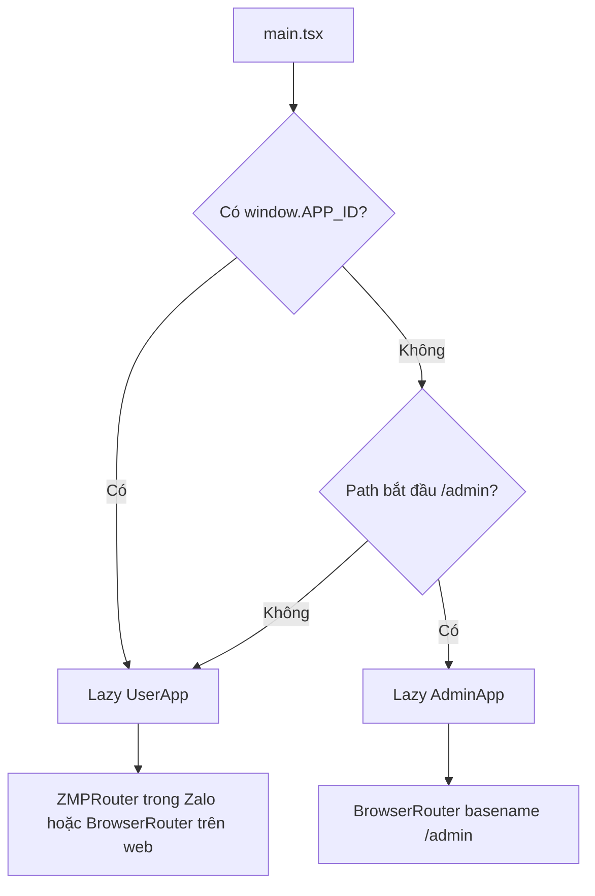
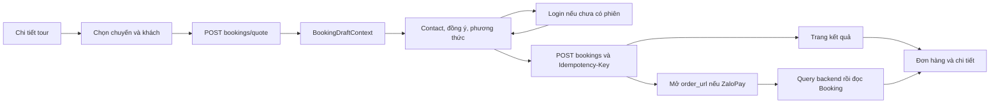

# Frontend VNA Đắk Song Booking Tour

Một dự án React/TypeScript phục vụ **giao diện khách web/Zalo Mini App** và **cổng quản trị web /admin**. Tài liệu đối chiếu source ngày **11/10/2026**. Xem [README tổng](../README.md) cho kiến trúc/nghiệp vụ và [README backend](../backend/README.md) cho hợp đồng API.

## Mục lục

1. [Cài đặt, cấu hình và lệnh](#1-cài-đặt-cấu-hình-và-lệnh)
2. [Kiến trúc và cấu trúc source](#2-kiến-trúc-và-cấu-trúc-source)
3. [Entry, provider và router](#3-entry-provider-và-router)
4. [Màn hình và route](#4-màn-hình-và-route)
5. [Component và cách tái sử dụng](#5-component-và-cách-tái-sử-dụng)
6. [Context và vòng đời state](#6-context-và-vòng-đời-state)
7. [Custom hook](#7-custom-hook)
8. [HTTP client, Zalo adapter và kiểu dữ liệu](#8-http-client-zalo-adapter-và-kiểu-dữ-liệu)
9. [Luồng đặt tour và thanh toán](#9-luồng-đặt-tour-và-thanh-toán)
10. [Nội dung, bản đồ, review và tài khoản](#10-nội-dung-bản-đồ-review-và-tài-khoản)
11. [Quản trị](#11-quản-trị)
12. [Preview, style và asset](#12-preview-style-và-asset)
13. [Kiểm thử](#13-kiểm-thử)
14. [Build web/Zalo và xử lý lỗi môi trường](#14-build-webzalo-và-xử-lý-lỗi-môi-trường)
15. [Nguyên tắc mở rộng và giới hạn](#15-nguyên-tắc-mở-rộng-và-giới-hạn)

## 1. Cài đặt, cấu hình và lệnh

Node.js theo engines `^20.19.0 || >=22.12.0`. Chạy tại frontend:

```powershell
npm.cmd ci
Copy-Item .env.example .env
npm.cmd run dev
```

Chỉ copy env khi chưa có cấu hình cần giữ. API backend cần chạy riêng; preview dev có thể dùng fixtures để xem UI.

| Biến công khai | Công dụng |
| --- | --- |
| VITE_API_BASE_URL | Base backend, mặc định http://localhost:8000; client tự thêm /api |
| VITE_ZALO_OA_ID | ID OA công khai để dựng liên kết hỗ trợ |
| VITE_SUPPORT_PHONE | Số hỗ trợ chính thức để hiển thị/liên hệ |

Không thêm /api vào VITE_API_BASE_URL. VITE_* xuất hiện trong bundle; không đặt JWT secret, Zalo secret, key provider hoặc mật khẩu tại đây. .env.local có thể ghi đè .env. Đổi env cần restart dev server hoặc build lại bản phân phối.

| Lệnh package.json | Ý nghĩa |
| --- | --- |
| npm.cmd run dev | Vite, localhost:5173, strictPort |
| npm.cmd run typecheck | tsc --noEmit |
| npm.cmd run build | Typecheck và Vite output dist/ cho web |
| npm.cmd run build:zalo | Typecheck và Vite/plugin output www/ |
| npm.cmd run preview | Phục vụ dist tại localhost:4173, strictPort |
| npm.cmd run test:ui | Chrome UI tổng hợp |
| npm.cmd run test:notifications | Chrome notification/header |
| npm.cmd run test:scroll | Chrome cuộn/tab/refresh |
| npm.cmd run test:explore | Node test khử trùng/phân trang catalog |
| npm.cmd run test:admin | Chrome cổng quản trị |
| npm.cmd run test:locations | Node test helper vị trí/cung đường |

Không có package ở root điều phối tự động hai phần. Test UI cần server đang chạy; typecheck/build không cần gọi database.

## 2. Kiến trúc và cấu trúc source

Frontend dùng **component + custom hooks + Context**, không có Redux/React Query. Đây là SPA: router chọn page; page đọc API/Context, ghép component và xử lý thao tác. MVC là cách tổ chức backend; React frontend là lớp trình bày ở cấp hệ thống, không có Controller/Model folder tương ứng từng page.

| Thư mục | Trách nhiệm | Dữ liệu không nên đặt nhầm |
| --- | --- | --- |
| pages | Màn hình và orchestration theo route | Không tự quyết giá/quyền thay server |
| components | Khối UI dùng lại, props/callback/state cục bộ | Không nhân bản toàn màn hình chỉ để đổi resource |
| context | State dùng qua nhiều màn hình | Không phải tất cả state local đều cần Context |
| hooks | State/effect/bất đồng bộ tái sử dụng | Không phải hook là cache server toàn hệ thống |
| utils | HTTP client, adapter, format, validation, catalog/vị trí | Secret backend không thuộc đây |
| types | Hợp đồng TypeScript | Không thay runtime validation |
| data | Fixtures/sample nội dung | Không coi preview booking là đơn thật |
| styles/assets | Bố cục, ảnh/font, nguồn | Không thay ảnh API lỗi bằng nội dung mẫu gây nhầm |

```text
src/
├── main.tsx
├── UserApp.tsx
├── App.tsx
├── pages/
│   ├── Auth/LoginPage.tsx
│   ├── User/
│   │   ├── HomePage.tsx, ExplorePage.tsx, ArticleDetailPage.tsx
│   │   ├── tours/ToursPage.tsx, TourDetailPage.tsx
│   │   ├── destinations/DestinationDetailPage.tsx
│   │   ├── booking/
│   │   │   ├── SelectDeparturePage.tsx, ReviewBookingPage.tsx
│   │   │   ├── BookingSuccessPage.tsx, MyBookingsPage.tsx
│   │   │   └── BookingDetailPage.tsx
│   │   └── account/AccountPage.tsx
│   └── Admin/
│       ├── AdminApp.tsx, LoginPage.tsx, DashboardPage.tsx
│       ├── BookingsPage.tsx, ContentPage.tsx
│       └── DeparturesPage.tsx, CouponsPage.tsx
├── components/
│   ├── common/
│   ├── layout/
│   ├── tour/
│   ├── booking/
│   ├── account/
│   └── admin/
├── context/                   # 7 module Context
├── hooks/                     # 4 module hook
├── utils/
├── types/api.ts, admin.ts, location.ts
├── data/sample*.json, preview*.ts
├── assets/
└── index.css, styles/
```

React `^18.3.1`, Router `^6.30.1`, Vite `^5.4.14`, TypeScript `~5.9.0`, zmp-sdk `^2.53.0`, zmp-ui `^1.11.14`, Leaflet `1.9.4` là khai báo manifests. ZaUI cung cấp App/Snackbar/ZMPRouter; phần lớn UI là HTML/SVG/CSS riêng.

## 3. Entry, provider và router

### Chọn nhánh ứng dụng



Root DOM là app trong index.html. createRoot đặt React.StrictMode và Suspense fallback. main.tsx đặt data attribute vnaZalo/vnaAdmin cho style theo môi trường. Nhánh admin chỉ trên web, không được chọn trong Zalo ngay cả khi đường dẫn giống /admin.

### Provider khách

Theo thứ tự trong UserApp.tsx:

```text
ZaUI App
└── SnackbarProvider
    └── PreviewProvider
        └── AuthProvider
            └── BookingDraftProvider
                └── NotificationProvider
                    └── Router
                        └── MainApp (App.tsx)
                            └── PageRefreshProvider
                                └── MainContent
```

Preview bao Auth để auth bỏ qua đăng nhập thật khi xem mẫu. Notification cần auth để phân biệt guest/user. Router bọc các màn dùng useLocation/useParams/AppLink. PageRefreshProvider bao shell để hook từng màn đăng ký refresh.

### Shell khách và admin

App.tsx giữ vùng cuộn .page-content, reset scroll khi pathname đổi; render Routes và bottom tabs. Tab chỉ hiện tại /, /explore, /tours, /my-bookings, /account. Bấm lại tab cuộn về đầu, tôn trọng prefers-reduced-motion.

PullToRefresh bật ở tab chính và chi tiết tour/điểm đến/bài viết. AdminApp dùng AdminAuthProvider/AdminToastProvider, RequireAdmin và AdminLayout với Outlet; phiên/router/style admin độc lập với khách.

## 4. Màn hình và route

### Khách hàng

| URL | Page | Hành động và dữ liệu |
| --- | --- | --- |
| / | HomePage | Đọc điểm đến/tour, mở danh mục và chi tiết |
| /explore | ExplorePage | Tab điểm đến/cẩm nang, lọc/phân trang và nhớ cuộn |
| /articles/:id | ArticleDetailPage | Nội dung, ảnh, nguồn bài viết |
| /tours | ToursPage | Tìm q, theme, duration, sort, phân trang API |
| /tours/:id | TourDetailPage | Nội dung/chính sách/chuyến, lưu tour, reviews, bản đồ, bắt đầu đặt |
| /destinations/:id | DestinationDetailPage | Mô tả/gallery/nguồn và tour liên quan |
| /booking/:id/select | SelectDeparturePage | :id là tour; chọn Departure/số khách/coupon, lấy quote |
| /booking/:id/review | ReviewBookingPage | :id là tour; đọc draft, contact/note, chọn tiền, đồng ý và gửi |
| /booking/success/:id | BookingSuccessPage | :id là booking; đọc kết quả server, trạng thái và tiếp tục thanh toán |
| /my-bookings | MyBookingsPage | Đơn của mình, filter trạng thái và payment sync |
| /my-bookings/:id | BookingDetailPage | Snapshot, tiền/chuyến/history, hủy có lý do, thanh toán, hỗ trợ |
| /account | AccountPage | Profile/hạng/điểm, đơn sắp đi, thống kê, saved tour, panel hướng dẫn |
| /login | Auth/LoginPage | Zalo hoặc mock web, returnTo |
| * | Fallback trong App | Không tìm thấy trang, về trang chủ |

Các trang khám phá công khai. Các màn đơn/tác vụ có kiểm auth trong page, không có RequireUser chung bao toàn router. Backend vẫn quyết quyền đọc/ghi.

### Quản trị, prefix /admin

| URL | Page | Chức năng |
| --- | --- | --- |
| /admin/login | Admin/LoginPage | Email/password |
| /admin | DashboardPage | Chỉ số API, đơn gần đây, tour có khách |
| /admin/bookings | BookingsPage | Danh sách/bộ lọc |
| /admin/bookings/:id | BookingsPage | Chi tiết, status và payment/refund |
| /admin/tours, /admin/destinations, /admin/articles | ContentPage | List theo resource |
| /admin/:resource/new | ContentPage + ContentForm | Tạo, chỉ ba resource trên |
| /admin/:resource/:id/edit | ContentPage + ContentForm | Sửa |
| /admin/departures | DeparturesPage | Chuyến/giá/hạn nhận |
| /admin/coupons | CouponsPage | Điều kiện ưu đãi |
| Route admin khác | Empty trong AdminApp | Không tìm thấy trang |

RequireAdmin chờ kiểm phiên, chuyển về login nếu chưa có user; nếu token còn nhưng API lỗi thì cho thử lại/đăng xuất. Backend vẫn kiểm adminOnly trên endpoint.

## 5. Component và cách tái sử dụng

### common

| Component | Vai trò và cách dùng |
| --- | --- |
| Icon | SVG theo name/size, bộ icon khách |
| Photo | src/alt, lazy/eager, placeholder khi thiếu/lỗi; hideOnError tùy chọn |
| ImageGallery | Nhận images, xếp figure/caption dọc để cuộn |
| AccountAvatar | Avatar tài khoản, fallback icon |
| States | LoadingState, ErrorState có retry, EmptyState có CTA |
| AppLink | Link router tự giữ preview query |
| useAppNavigate trong AppLink | Điều hướng string/number, giữ preview, hỗ trợ replace |

Photo gọi resolveImageUrl trước hiển thị. Có mapping chính xác năm URL Nâm Nung ở imageUrl.ts và caption fallback; không rewrite mọi ảnh hoặc thay toàn bộ bằng ảnh stock.

### layout

| Component | Vai trò |
| --- | --- |
| Header | Tiêu đề/back/fallback, account và notification tùy màn |
| BottomNavigation | 5 tab chính, callback khi chọn lại |
| NotificationBell | Mở panel thông báo, filter/read/loadMore qua Context |
| PullToRefresh | Touch khi đầu vùng cuộn, gọi handler đã đăng ký |
| AdminLayout | Sidebar/menu responsive, header, overview và Outlet |

PullToRefresh tránh input/textarea/select/contenteditable, dialog đang mở, kéo ngang/nhiều ngón và tác vụ refresh trùng. Ngưỡng kéo hiển thị 64 px; refresh không reload toàn trang.

### tour, booking, account

| Component | Vai trò |
| --- | --- |
| TourCard | Card tour, giá từ API/tham khảo và link chi tiết |
| DestinationCard | Card điểm đến, ảnh/thông tin/link |
| RatingStars | Hiển thị hoặc chọn số sao theo props |
| TourReviews | Danh sách/form, eligibility, gửi/sửa/xóa và callback refresh |
| TourLocationMap | Marker địa điểm và link vị trí/cung đường |
| GuestCounter | Số khách và nút tăng/giảm theo giới hạn props |
| CouponPicker | Đọc coupon khả dụng, kiểm minOrderValue để hiển thị, chọn/bỏ mã |
| BookingSteps | Hai bước chọn chuyến/kiểm tra gửi |
| BookingProgress | Trình bày tiến trình từ Booking.status |
| BookingTicketCode | Mã đơn thật; QR minh họa chỉ preview |
| AccountMenuItem | Mục tài khoản với icon/nhãn/hành động |

Page điều phối phần dữ liệu/nghiệp vụ của màn; component có thể chứa state/hook. TourReviews gọi API mutation, CouponPicker đọc API; source không bắt mọi component là presentational thuần.

### admin

| Module | Thành phần |
| --- | --- |
| ui.tsx | Button, Badge, PageHeader, Notice, Empty, Loading, QueryState, Pagination, Field, Modal, Confirm, Stat, Photo |
| Icon.tsx | Bộ SVG quản trị |
| ContentForm | Form chung tạo/sửa tours/destinations/articles, validation và mutation |
| ContentFields | ImageFields, SourceFields, ItineraryFields và re-export DestinationPicker |
| DestinationPicker | Tìm/lọc theo nhóm/khu vực, chọn nhiều điểm, sắp thứ tự kéo hoặc Lên/Xuống |

Dùng chung form theo resource giúp field ảnh/nguồn/quan hệ không lặp lại ở ba page. Admin UI có style/nhãn riêng; component admin Photo khác common Photo của khách.

## 6. Context và vòng đời state

| Context | State/hành động | Vòng đời |
| --- | --- | --- |
| PreviewContext | isPreview, previewBooking, setPreviewBooking | isPreview chốt lúc mount, chỉ DEV && preview=1 |
| AuthContext | user/loading/login/logout/refreshProfile | Token adapter storage, kiểm /auth/me |
| BookingDraftContext | draft/setDraft, attempt/setAttempt | Bộ nhớ React, không persist reload |
| NotificationContext | data/loading/error/type, refresh/read/loadMore | Scoped guest/user/filter/limit; polling |
| PageRefreshContext | register/refresh, usePageRefreshHandler | Handler màn đang mount; gom Promise.allSettled |
| AdminAuthContext | user/checking/error/login/logout/retry | Token sessionStorage riêng, /auth/me, role check |
| AdminToastContext | Thông điệp toast/useToast | UI admin, aria-live, đóng được |

Danh sách trên có **7 module Context**. Auth khách và admin tách phiên/client; không dùng một token chung cho cả hai luồng.

BookingDraft chứa tourId, Departure, adults/children, Quote, contact và note. Attempt chứa key và payload đã gửi; đây là dữ liệu quan trọng khi kết quả mạng chưa rõ. Điều hướng/login trong cùng app giữ draft, refresh trình duyệt làm mất draft/attempt.

Auth khách đọc storage rồi /auth/me; 401/403 xóa token lưu. Login đặt Authorization và lưu token; logout xóa token/user. Account logout còn xóa draft/attempt. Admin gặp 401 từ response interceptor phát sự kiện admin-session-expired để logout.

NotificationContext đọc theo scope user:type:limit, không hiển thị data scope cũ khi user/filter đổi. Polling 30 giây khi tab hiển thị, focus/visibilitychange và vna-booking-updated. loadMore tăng limit 20 đến tối đa 100; chưa tải vô hạn sang các page sau 100.

PageRefreshContext giữ handler trong Set, gom kết quả allSettled, chặn refresh trùng; lỗi một handler báo cập nhật chưa đầy đủ. Không có cache dữ liệu chung tự đồng bộ mọi page.

## 7. Custom hook

| Hook | Hành vi chính | Giới hạn |
| --- | --- | --- |
| useApi<T> | GET hoặc reader tùy chọn, loading/error/data, retry, refresh/refreshError, AbortController, đăng ký page refresh | Request đọc; mutation vẫn tại handler |
| useBookingPaymentSync | Lấy detail, query giao dịch pending/success, đọc lại Booking, refresh page | Chỉ theo dõi booking zalopay unpaid được truyền vào |
| useQuery<T> trong useAdminQuery | GET/path, loading/error/retry/updatedAt; nghe admin-data-changed | Không polling dashboard liên tục |
| useOptions<T> | allPages cho options admin | Đọc đủ page, có thể tốn request khi catalog lớn |
| useFilters | URL params, page/limit/update/reset | Giá trị filter vẫn cần backend kiểm |
| useAdminForm | dirty/busy/error/touch/close, beforeunload và confirm bỏ sửa | Không thay server validation |

useApi hủy request khi path đổi/unmount, tránh dùng response cũ. Refresh thất bại giữ data hiện có và set refreshError; initial lỗi dùng error. isPreview dùng previewData thay request; thiếu fixture báo không tìm thấy trong bản mẫu. path=null ngừng đọc API.

Payment sync interval 5 giây, bỏ qua khi trang hidden, chạy khi focus/visibilitychange. Có pending promise để không chồng lần kiểm. Query lỗi vẫn đọc lại DB vì webhook có thể đã ghi paid. Kết quả đổi thì refresh page và phát vna-booking-updated. Không đọc query redirect để quyết paid.

## 8. HTTP client, Zalo adapter và kiểu dữ liệu

### API khách/admin

utils/api.ts: BASE_URL lấy env hoặc localhost, bỏ slash cuối, axios baseURL = BASE_URL + /api, timeout 15 giây. setApiToken đặt/xóa Authorization mặc định. API_PATHS chỉ là map một phần; nhiều page vẫn dùng path trực tiếp. API_PATHS.REVIEWS.GET_BY_ID dùng cho PATCH/DELETE, không chứng minh backend có GET review detail.

utils/adminApi.ts tạo Axios riêng, token biến module, request interceptor, 401 event, changed() để phát admin-data-changed, query() ghép filter, allPages() lấy từng page limit=100, errorMessage() chuyển lỗi sang nhãn phù hợp.

Không có proxy Vite /api trong config; request gọi thẳng base backend. Frontend không có controller quyết quyền hoặc tổng tiền thay server.

### Adapter Zalo

utils/zalo.ts kiểm window.APP_ID:

- readSession/storeSession dùng nativeStorage khi Zalo, sessionStorage trên browser; key vna-customer-session.
- zaloLoginCredentials xin getUserInfo với quyền tùy chọn, sau đó getAccessToken, gửi accessToken/includeProfile.
- SDK profile không được gửi nguyên làm danh tính backend; server xác minh token và tự đọc hồ sơ.
- Adapter có helper bookmark điểm đến dùng native/session storage, nhưng giao diện hiện tại chưa gọi các helper này.

Phiên admin key vna-admin-session trong sessionStorage. Không dùng localStorage/cookie login theo source hiện tại.

LoginPage lọc returnTo bắt đầu / và không //, rồi quay lại sau thành công. Browser có form mock; API có mở hay không phụ thuộc backend. Preview không tạo phiên thật. App khám phá không yêu cầu follow OA.

### Types và helper

| File | Vai trò |
| --- | --- |
| types/api.ts | Tour/Destination/Departure/User/Quote/Booking, review/payment và list response |
| types/admin.ts | Resource và field quản trị/dashboard/payment |
| types/location.ts | PlaceLocation/Coordinates/PlaceGroup/AreaScope |
| utils/inputValidation.ts | Contact, text, URL, date, số nguyên; UX kiểm sớm |
| utils/format.ts | VND, duration, dateTime Asia/Ho_Chi_Minh, nhãn |
| utils/booking.ts | Nhãn/description status tiền/chuyến/history |
| utils/adminPresentation.ts | Nhãn/tone, tiền/ngày/form ngày/slug admin |
| utils/readCatalog.ts | Tải đủ trang article/destination trước lọc UI |
| utils/exploreCatalog.ts | Khử trùng theo alias xác định, catalogPage mặc định 8 |
| utils/tourLocations.ts | Tọa độ, nhãn nhóm/khu vực, link vị trí/chặng |
| utils/imageUrl.ts | Mapping ảnh/caption cụ thể |

Types chỉ kiểm lúc compile. Backend model và HTTP validator có thể khác nhau; ví dụ schema có maxCapacity nhưng form/API chưa sửa. Giữ API type phù hợp response, không suy runtime contract từ tên type.

## 9. Luồng đặt tour và thanh toán



### Chọn chuyến

SelectDeparturePage lấy Tour và chuyến /tours/:id/departures?page=...&limit=12. Lọc chuyến open/chưa hết deadline/chưa đi. GuestCounter điều chỉnh số khách; childPrice null không cho chọn vé trẻ em. estimated trên UI chỉ phục vụ hiển thị/điều kiện coupon, không gửi total để tạo đơn.

Bấm tiếp gọi quote với departureId/adults/children/couponCode; server kiểm tổng chỗ/chính sách/coupon. Có attempt chưa rõ thì chặn đổi lựa chọn để giữ yêu cầu trước. Quote xong lưu draft, mở bước review.

### Kiểm tra và gửi

ReviewBookingPage khớp draft.tourId với route. Không có draft thì hướng khách chọn chuyến lại. Contact gồm tên/phone/email bắt buộc, note tùy chọn; validation frontend và backend. Quote hết hạn theo timer mỗi giây hoặc lỗi 409 thì yêu cầu lấy quote mới và đồng ý lại.

Chưa login thì navigate /login?returnTo=...; Context giữ draft. Phương thức UI hiện có cash_on_arrival/zalopay; qr_transfer chỉ là enum/type tương thích, không lựa chọn đặt mới.

Lần gửi mới tạo crypto.randomUUID làm key, đóng băng payload trong attempt. Ref sending và busy chặn double click. POST /bookings gửi Authorization và Idempotency-Key. Lỗi mạng/5xx giữ attempt để gửi lại đúng key/payload; lỗi có response <500 bỏ attempt, 409 đánh dấu quoteInvalid.

Khi API tạo booking thành công, clear draft/attempt. Với ZaloPay thử tạo giao dịch, nếu có order_url mở window.location.href; nếu API tiền lỗi thì vẫn đi kết quả vì booking đã tạo, khách có thể kiểm tra/tiếp tục sau. Không tạo lại booking chỉ vì thanh toán chưa hoàn tất.

### Kết quả, đơn và tiền

BookingSuccess/MyBookings/BookingDetail đọc server; trạng thái đặt tour và tiền hiển thị riêng từ Booking.status/paymentStatus. Mới tạo là pending_confirmation/unpaid. Các page dùng useBookingPaymentSync để đối soát và refresh.

BookingDetail cho hủy có reason khi phù hợp, thanh toán ZaloPay nếu đủ điều kiện, history và hỗ trợ bằng cấu hình OA/phone. Server kiểm lại owner/status. Đơn thật hiển thị mã VNA; QR trong preview là minh họa không check-in.

Quote chưa giữ chỗ, createBooking backend chưa kiểm lại tổng capacity trong transaction. Frontend không nên báo chắc chắn có chỗ chỉ vì quote thành công.

## 10. Nội dung, bản đồ, review và tài khoản

### Explore và tour

Explore có tab destinations/guides, category/guideCategory, page/guidePage riêng trên URL. readCatalog lấy mọi trang server limit=100; uniqueDestinations chỉ merge alias slug đã xác định, ưu tiên bản có coordinates, giữ ID thật. UI catalogPage 8 mục, nhớ scroll từng tab/API-preview trong bộ nhớ module.

ToursPage lấy query q/theme/sort/maxDurationHours/page, gọi API limit=8, reset page khi filter đổi. Backend hỗ trợ thêm date/price/destination filter nhưng UI này không tự có toàn bộ bộ lọc chỉ vì API hỗ trợ.

Chi tiết bài/điểm dùng text/gallery/nguồn. Lưu tour cần auth và /tours/:id/save, User.savedTours. Giao diện hiện tại chưa có thao tác lưu điểm đến.

### Bản đồ

TourLocationMap dùng Leaflet với tile OpenStreetMap và attribution, fitBounds/marker theo tọa độ. Popup dựng bằng DOM/textContent. Meeting destination đưa lên đầu, điểm thiếu tọa độ được báo và vẫn liệt kê; tile lỗi vẫn có link bên dưới.

getRoutePoints chỉ giữ tọa độ hợp lệ. buildRouteLinks chia thành chặng tối đa 5 điểm (origin, 3 waypoint, destination), chặng nối chung điểm cuối/đầu. Đây là liên kết Google Maps, không phải backend tối ưu tuyến; map trong app không vẽ đường lái xe hay tính GPS/quãng đường.

### Reviews

TourDetail đọc danh sách/summary; TourReviews đọc eligibility nếu có user. Create gắn booking completed, sửa rating/comment, xóa có confirm; sau mutation refresh list/summary/eligibility. Nội dung comment hiển thị dạng text. Backend kiểm owner/booking; reviewCount/averageRating từ dữ liệu thật, không thêm rating mẫu trong chế độ API.

### Account

Profile/hạng/điểm từ /auth/me; confirmed và completed từ /bookings/mine; saved tour từ /tours/saved; chuyến sắp đi là confirmed chưa khởi hành gần nhất. Trip count cộng tổng confirmed/completed, không phải toàn bộ đơn đã gửi.

Hạng backend có **Bạc, Vàng, Kim Cương**, ngưỡng 1000/5000. Thanh progress là logic trình bày riêng: khi Bạc ≤500 điểm, targetPoints ở helper là 500, sau đó 1000; nhãn vẫn hướng tới Vàng. Không dùng phần trăm progress làm quy tắc nâng hạng thay backend.

Panel saved hoạt động bằng API. Panel hành khách/ảnh/ví/ZNS/chính sách/FAQ có phần thông tin/preview; chưa có CRUD profile hành khách, ví tiền, upload ảnh kỷ niệm hay ZNS service. Nhãn “Thông báo hành trình ZNS” không chứng minh tích hợp gửi ZNS. Hỗ trợ chỉ có đường liên hệ thật khi env cung cấp hợp lệ.

Panel payments trong AccountPage vẫn có câu hướng dẫn cũ rằng ZaloPay chưa được tích hợp, trong khi các trang booking đã có luồng gọi API ZaloPay. Đây là nội dung UI chưa đồng bộ trong source; khi xác định khả năng thanh toán, đối chiếu luồng booking và paymentController. Panel coupon tài khoản cũng chưa đọc danh sách coupon khả dụng; CouponPicker ở bước chọn chuyến mới là nơi đang dùng API ưu đãi.

## 11. Quản trị

AdminAuthContext kiểm token /auth/me và role admin, login /auth/admin/login. Session/client tách khách. AdminLayout đọc dashboard qua useQuery, truyền overview bằng Outlet context và useOverview. Refresh dùng changed() hoặc retry; không có WebSocket hoặc polling tự động dashboard liên tục.

Dashboard đọc thêm booking gần đây và tours sort most_bought. totalRevenue backend là tổng snapshot của confirmed/completed, chưa lọc paid; không diễn giải như tiền thực thu.

BookingsPage điều phối detail/status/query/refund; UI chặn/báo kết quả chưa rõ, backend quyết transition. Refund mới là gửi yêu cầu; cần query xác nhận. Không có API/UI hoàn một phần hoặc đánh dấu tiền mặt đã thu.

ContentPage dùng resource config cho list/new/edit. ContentForm nhận resource/initial/onClose, useAdminForm giữ dirty/busy, field chung và field từng loại. Upload gọi /upload field image, tối đa 5 MiB theo backend; form giữ URL/alt/credit và sources. PUT/POST xong changed()/toast để các query đọc lại.

DestinationPicker lọc địa điểm không archived theo tên/địa chỉ/khu vực/nhóm, chọn nhiều điểm, có thứ tự cho tour. Form point location chỉ bật với bản mới hoặc bản cũ đã có placeGroup, không tự áp default location cho mọi destination cũ. Meeting destination nằm trong tuyến; itinerary destinationId thuộc destinationIds; API kiểm lại.

Tour form không phải màn sửa referencePrice, Departure form không sửa maxCapacity vì request whitelist chưa nhận. Nguồn Tour hiện không có editor sources tương tự Destination/Article. Nội dung DELETE là archive, chuyến DELETE là closed; coupon DELETE xóa thật. Không gọi mọi thao tác “xóa” là cùng cơ chế.

## 12. Preview, style và asset

Preview bật khi import.meta.env.DEV và query preview=1 lúc mount. Dùng:

```text
http://localhost:5173/?preview=1
```

AppLink/useAppNavigate giữ preview query qua điều hướng. PreviewContext giữ booking mẫu, auth bỏ qua phiên thật, useApi lấy fixture; tạo đơn mẫu không gọi POST booking thật. Preview không xác nhận thanh toán, capacity, login hoặc quyền thiết bị. Đổi sang chế độ API bằng link trong banner. Preview không bật chỉ bằng query trên production.

| Dữ liệu | Công dụng |
| --- | --- |
| sampleTours/Destinations/Articles.json | Nội dung sample được preview/script backend sử dụng |
| preview.ts | Tour/chuyến/list/images mẫu |
| previewAccount, previewBookingDetail, previewReviews | Fixture tương ứng UI |
| previewExplore, previewArticles | Catalog/cẩm nang minh họa |

UserApp import ZaUI CSS, font Inter local, index.css và style từng màn. Các module account/reviews/booking/explore/notifications/coupons/zalo-layout phân tách vùng UI. TourLocationMap import tour-locations.css/Leaflet CSS. AdminApp import admin.css riêng. Tailwind/PostCSS có cấu hình trong repository; phần lớn bố cục chi tiết dùng CSS thủ công.

app-config.json đặt actionBarHidden=true vì Header frontend tự dựng. zmp-vite-plugin sinh config asset cho build. Safe area/Zalo layout dựa data attribute và CSS; vẫn cần kiểm thiết bị thật.

Ảnh cần build được commit trong assets; sources.json/reference-sources.json/explore-sources.json giữ nguồn. Font Inter kèm [SIL OFL](src/assets/fonts/Inter-OFL.txt). Bộ Stitch và prepare-* local bị gitignore, không cần khi clone/build. Ảnh preview không tự chứng minh là ảnh thật đúng từng địa điểm; chế độ API lấy ảnh nội dung từ backend, ảnh lỗi dùng trạng thái rõ ràng.

## 13. Kiểm thử

Logic không cần server:

```powershell
npm.cmd run test:explore
npm.cmd run test:locations
npm.cmd run typecheck
```

Sau khi chạy dev server ở terminal riêng:

```powershell
npm.cmd run test:ui
npm.cmd run test:notifications
npm.cmd run test:scroll
npm.cmd run test:admin
```

Harness Chrome headless qua CDP, mặc định C:/Program Files/Google/Chrome/Application/chrome.exe; đặt CHROME_PATH/UI_BASE_URL để đổi. Không cần thêm Playwright vào package hiện tại.

| Harness | Phạm vi |
| --- | --- |
| scripts/check-ui.mjs | Màn đại diện mobile, booking, lỗi/quote/idempotency, payment/review; có intercept ghi API |
| scripts/check-notifications-ui.mjs | Header/avatar/notification UI và điều kiện môi trường |
| tests/scroll-ui.mjs | Scroll từng tab, điều hướng/filter/refresh |
| tests/admin-ui.mjs | Login/guard/list/form/booking/payment admin với API fixtures |
| tests/explore-catalog.test.mjs | Alias và phân trang |
| tests/tour-locations.test.mjs | Coordinate/link/chặng |
| tests/destination-locations-ui.mjs | UI địa điểm kết hợp harness backend |

Test admin production smoke sau build và preview server:

```powershell
npm.cmd run test:admin -- --production-smoke
```

Mặc định smoke dùng localhost:4173. Test địa điểm kết hợp chạy từ backend:

```powershell
npm.cmd run test:locations:ui --prefix ../backend
```

Lệnh trên vẫn chạy khi cwd frontend; cần backend env/DB test, dev server và Chrome. Các LOCATION_* được harness backend cấp cho UI, không nhập token production vào tài liệu.

Ảnh/báo cáo tạo tại test-results, profile Chrome ở .browser-cache, bị gitignore. Test UI có fixture/intercept và một số đọc API thật theo điều kiện harness; xem cờ/báo cáo tương ứng. Browser test không kiểm chứng Zalo SDK/merchant/SMTP. Tài liệu không giữ số ca pass cũ như bằng chứng lần chạy hiện tại.

## 14. Build web/Zalo và xử lý lỗi môi trường

vite.config.ts bật react và zmp-vite-plugin, base='./', target es2018, không modulePreload polyfill, tên JS *.module.js. Web build override outDir dist; Zalo build để plugin output www.

### Web/Vercel

```powershell
npm.cmd run build
npm.cmd run preview
```

Vercel root frontend, output dist, cấu hình env trước build. vercel.json rewrite mọi route về index.html để /admin/* và URL chi tiết tải trực tiếp. Hosting SPA khác cũng cần fallback tương ứng. API URL phải truy cập được từ thiết bị dùng frontend.

### Zalo

```powershell
npm.cmd run build:zalo
```

Output www không commit. Công cụ Zalo cần app ID/tài khoản có quyền và đúng thư mục dự án. Deploy/build của extension dùng cấu hình plugin; nếu báo thiếu frontend/www thì kiểm plugin và build output. Không có script npm tự Publish.

Để thử backend trên máy tính qua HTTPS, dùng start/stop-zalo-local ở root như [README backend](../backend/README.md#15-chạy-production-vercel-và-tunnel-local). Sau đổi URL trong env.local cần build lại; điện thoại không gọi được backend máy tính qua localhost của điện thoại.

| Hiện tượng | Điểm kiểm tra |
| --- | --- |
| API bị /api/api | VITE_API_BASE_URL không thêm /api |
| Không gọi được backend | Base URL, HTTPS/network, backend/DB, env.local override |
| Cổng 5173/4173 đã dùng | strictPort cố định; dừng đúng phiên đang chiếm cổng hoặc chỉnh config có chủ đích |
| Reload bước review mất lựa chọn | Draft/attempt chỉ lưu memory; cần chọn lại |
| Mock 403 | ALLOW_MOCK_LOGIN/NODE_ENV backend |
| /admin reload 404 | Hosting thiếu rewrite index.html |
| Query preview không bật | Chỉ DEV, isPreview chốt lúc mount |
| Đã về redirect nhưng còn unpaid | Query backend/DB; URL chưa là chứng cứ paid |
| Zalo login lỗi | SDK token, scope/app secret, API thật; web build chưa kiểm SDK |
| Avatar chưa có | Đăng nhập lại có consent, backend profile; ảnh lỗi dùng fallback |

## 15. Nguyên tắc mở rộng và giới hạn

Thêm page cần route trong App/AdminApp, type response, loading/error/empty, API đọc và handler mutation. Chọn Context nếu state cần qua nhiều màn; chọn component nếu khối UI tái sử dụng; dùng hook nếu logic effect/state lặp lại. Mutation vẫn có thể nằm ở page nhưng phải xử lý busy, kết quả chưa rõ và lỗi.

Thêm field quản trị phải kiểm HTTP whitelist backend, model, type, form và response. Không suy tính năng từ label panel hoặc enum type. Giữ phiên/router khách và admin riêng; API quyền/giá luôn do server. Khi sửa trạng thái, đồng bộ nhãn booking/payment/history, notifications và các page hiển thị.

Giới hạn hiện tại: attempt không persist reload; notification loadMore tối đa 100; chưa WebSocket; chưa ví/hồ sơ hành khách/kho ảnh/ZNS/check-in; tiền mặt chưa có ghi nhận thủ công; app dùng window.location.href mở ZaloPay nên hành vi trên Zalo thật cần kiểm riêng. Build/typecheck/fixture UI là các mức kiểm tra khác với SDK/provider và phát hành.
